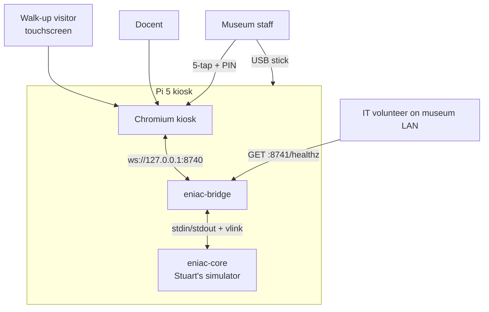
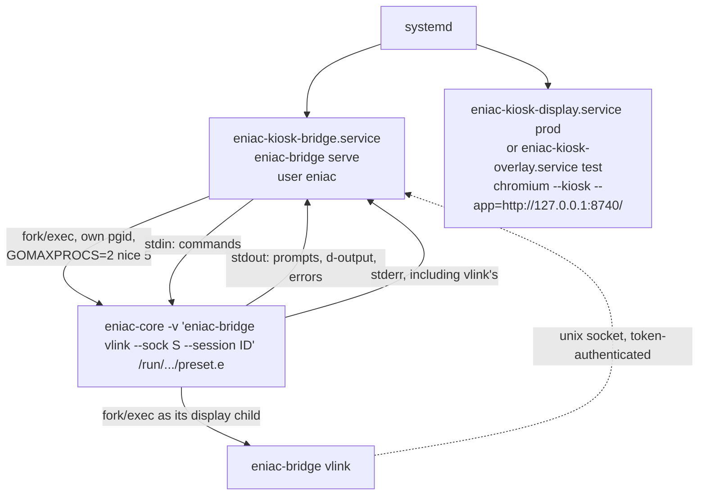
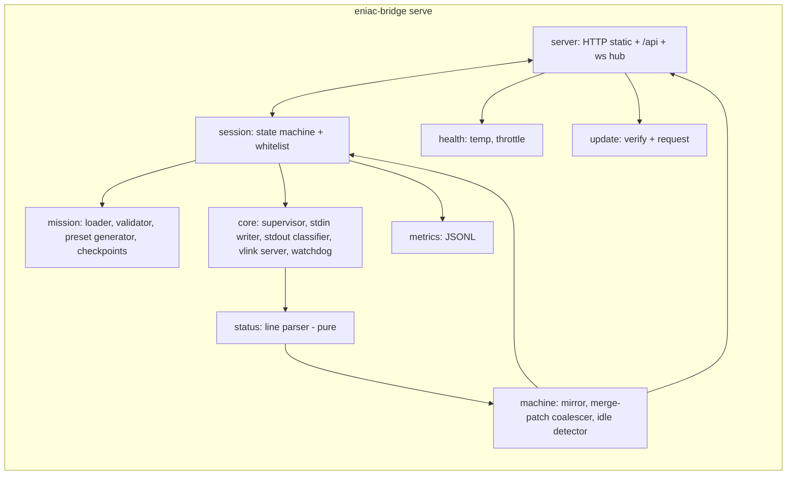
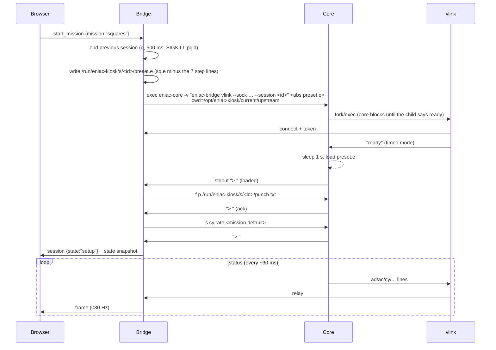
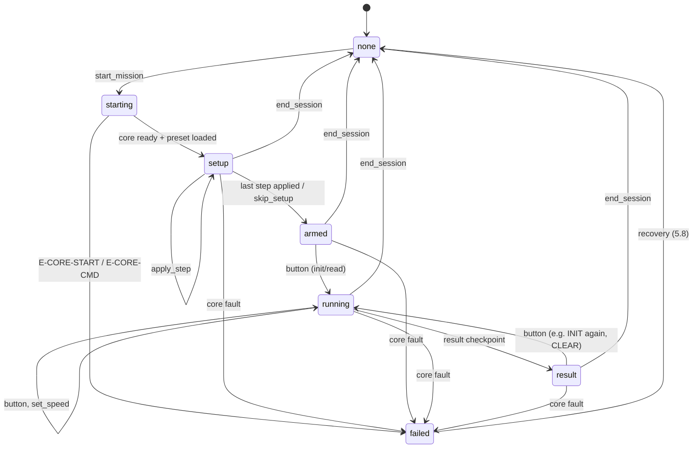
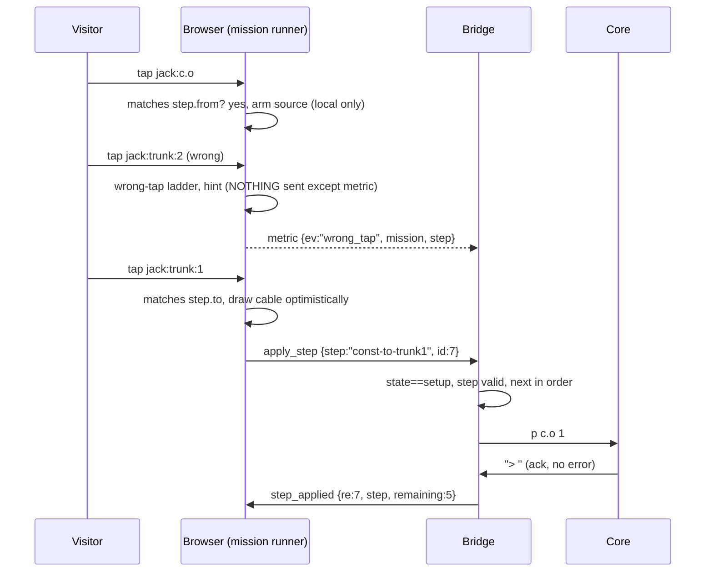

# Software Architecture: ENIAC Touch Kiosk

**Version:** 0.5
**Last Updated:** 2026-10-01
**Author:** Nick DeMarco with AI assistance (software-architecture agent)
**Status:** Draft for review
**PRD Reference:** `docs/PRD.md` v0.1 (as corrected in `fe4c96d`)
**UX Reference:** `docs/ux-spec.md` v0.1. This document defines the data and protocol contracts the UI consumes. It does not define screens or visual design.

**Grounding:** upstream `blstuart/eniac-simulator` at `c4b94f2ca9ea59dd3fdb05ddf5e29a08c7ce569a` (2026-09-22). I read `src/eniac.go`, `src/engine.go`, `src/cycle.go`, `src/initiate.go`, `src/printer.go`, the `*stat()` functions in `src/{accumulator,mp,ft,constant,mult,divsr}.go`, `vis/eniactk.go`, `vis/ansi.go`, `programs/{sq,sieve,trajdemo,drag}.e`, `demo.card` and `images/`. I also **built and ran the core on macOS** with a stub display child and recorded its real status stream. Every claim tagged **[verified]** was observed in those runs.

---

## 0. Findings from the upstream code that shape this design

Read these first. Several of them change what the PRD assumed.

| # | Finding | Evidence | Consequence |
|---|---|---|---|
| U1 | **`sieve.e` does not run at the pinned commit.** After INIT the function-table ring counter runs away (`ftr` keeps increasing, e.g. `02 66014`) and no cards are punched in 40 s. At `f611c7f~1` (just before the 2025-07-08 "Rework function table code…" commit) the same run punches 35 cards in 20 s. At `f611c7f` itself it punches 0. | [verified] on macOS, with and without `-v`. | **The Primes mission (M2) is blocked** until upstream fixes it or the PRD allows a second local patch (NFR-12 currently allows only `mult.go`). Report it to Stuart together with the `mult.go` bug (R2). Squares (M1) is unaffected. Trajdemo does punch cards at `c4b94f2`, but has not been run end to end. **Resolved 2026-10-01 (decision #36):** `patches/0002-ft-repeat-default.patch` (spike S3); `sieve.e` punches the 407 primes from 3 to 2801 and `sieve-canary` passes. |
| U2 | **Loading a `.e` over stdin straight after start-up can deadlock the core.** `initupdate` and `intbch` are created inside goroutines, and `main` only covers this with a 1 s sleep before an argv load. Sending `l sq.e` on stdin at once hung 4 of 30 runs. Passing the file as argv hung 0 of 20. | [verified] | The bridge **always passes the preset config as the argv file** and treats the first `> ` prompt as "loaded". A fresh core is ready in about **1.0 s**, set by the upstream sleep. [verified] |
| U3 | **sq.e computes one square per INIT** (x → x+1, x² → (x+1)²). It does not loop. | [verified] 1/1, 2/4, 3/9 | "Keep pressing for me" is a UI-side repeat of the whitelisted INIT action. It needs a reliable **INIT-finished (idle)** signal from the bridge (section 5.6). |
| U4 | **Handshake mode (`update`) busy-spins a CPU core** whenever nothing has changed. The status loop has no sleep on the no-change path. `eniactk` uses handshake mode. | `engine.go` status goroutine | The bridge uses **timed mode (`ready`)**, which samples every 30 ms. There is no `up` frame marker in timed mode, so the bridge frames the data itself. |
| U5 | **Any line the display child writes is executed as a core command** (`proccmd(engmsg)`), on a different goroutine from the stdin command loop. | `engine.go` | The display child is a tiny **vlink** relay that can only ever write `ready`. All commands go through core **stdin**, one at a time. This gives one serialized command path with per-command acknowledgement (the `> ` prompt). |
| U6 | **`trajdemo.e` runs itself on load.** Its last lines are `b c`, `b r`, `b i`. It also includes another file (`l drag.e`) and opens `f r demo.card` **relative to the core's working directory**, not `programs/`. | `trajdemo.e:22,486,839-841` | The mission format has **withheld lines** (bound to UI buttons) and supports included files. The core's cwd must be a runtime directory containing `programs/` and `demo.card`. |
| U7 | **Status wire quirks:** sign is sent as `ad u 0 0` (P) or `ad u 0 3` (M). Unit numbers are 0-based on the wire and 1-based in `.e` files. MP `inff` values of 10 or more are printed as `*` and arrive as **250** (byte underflow). The FT ring starts at **-3**. `m` has a double space when the stage is below 10 (the `%2d` bug). `punch` payloads are 80 characters with **embedded spaces**. `cy` changes on almost every 30 ms tick even when the machine is idle. `refresh` does not re-send `init` or a `cy` of 0. | [verified] + source | Section 5.3 specifies a parser that tolerates all of these. |
| U8 | **`go.mod` says `go 1.26`.** The trixie `golang-go` package is 1.24, so the core **cannot be built on the Pi from apt** without downloading a toolchain. | `go.mod` history: bumped 2026-09-22 | We **cross-compile on the Mac** (pure Go, `CGO_ENABLED=0`). The Pi needs no Go toolchain, and the trial's `golang-go` can be removed. |
| U9 | **The upstream photos have cables baked in.** Each section image tiles a composite (the UX spec's F3) at about 237 px per panel. There is **no jack or switch geometry anywhere upstream**, because `eniactk` can't plug anything. | `images/e1280s1.ppm` viewed | We author our own SVG panel kit, with jack, switch and lamp IDs that follow the `.e` grammar (section 6). Lamp positions can reuse the upstream offsets (49×38 panel-unit pitch). |
| U10 | **Full-speed runs are CPU-heavy.** Sieve at `cy.rate 0` used about 2.5 cores on an M-series Mac (user 18 s + sys 6 s in 9.6 s). | [verified] | Cap the core at `GOMAXPROCS=2` and `Nice=5` so Chromium keeps its share on the Pi 5. Measure in the M1 spike (R3). |
| U11 | `R` (reset) nils accumulator and initiator connections, but not every unit. Upstream's own 2026-09-22 commit says reloading "doesn't behave the same as starting from scratch." | `accreset`, `initreset`, commit `1b20126` | Confirms the settled decision: **a fresh core process per mission**. |

---

## 1. Executive Summary

### 1.1 System overview

The kiosk is three processes on one Pi 5: **Chromium** in kiosk mode renders a local web app. The app talks over a localhost websocket to the **bridge**, a Go daemon. For each mission the bridge starts a fresh, unmodified (apart from the `mult.go` patch) **simulator core** and acts as its `-v` display child through a tiny relay (**vlink**). The bridge turns the core's line-based status stream into a mirrored machine state and sends coalesced JSON deltas to the browser at up to 30 Hz. The browser sends back only a small whitelist of intents: start mission, apply step *N*, press INIT, set speed, and so on. It never sends core commands.

Missions are data files. Each one references an unmodified upstream `.e` program, and marks certain lines as visitor steps or as withheld run buttons. At mission start the bridge writes a *preset* config (the `.e` minus those lines) and boots the core with it. As the visitor completes each step, the bridge sends that exact `.e` line to the core. The core's configuration is therefore always a known-good subset of the real program, and after setup it is identical to it.

Upstream is never vendored. The repo holds a pinned commit, a tree hash and a `patches/` directory. The build fetches, verifies, patches and cross-compiles the core into a signed release tarball, which is installed side by side with the previous release for one-tap rollback.

### 1.2 Key architectural decisions

| Decision | Choice | Rationale |
|---|---|---|
| Core ↔ bridge coupling | Bridge spawns core, `-v "<bridge> vlink …"`; vlink relays status to the bridge over a Unix socket. Commands go **only** to core stdin. | The websocket server outlives every core. There's one serialized command path with prompt-acks (U5). |
| Core lifecycle | Fresh process per session; preset loaded via **argv**; ready = first `> ` | No unplug (PRD), reload is unreliable (U11), stdin load can deadlock (U2) |
| Status mode | Timed (`ready`), bridge frames at 30 Hz | Handshake mode busy-spins (U4) |
| Wire format to UI | JSON over websocket: `state` snapshot + `frame` deltas using **JSON Merge Patch** (RFC 7396) | Trivial to apply, debuggable, small |
| Visitor-plug validation | In the browser. Only `stepId`s reach the bridge, which maps them to `.e` lines. | Wrong taps never touch the core (FR-14). The browser can't inject commands (FR-02). |
| INIT-finished signal | Bridge-computed `run` events (`busy` / `idle` with settled accumulator values) | Needed for re-arming INIT and the notebook tape (U3, UX F2) |
| Web stack | Vanilla TypeScript + SVG + CSS, bundled with esbuild (run as a Go tool). No framework, no runtime Node. | Section 9.1 |
| Upstream handling | `upstream.lock` (commit + tree hash) + a minimal set of local `patches/*.patch` (policy in 4.4), fetched into `build/`, cross-compiled | R1 (no license), NFR-12, U8 |
| Metrics | Append-only JSONL, monthly files, on-box | Simple, robust to power cuts, trivial CSV export |
| Releases | `/opt/eniac-kiosk/releases/<ver>` + atomic `current` / `previous` symlinks. Ed25519-signed tarballs. | One-tap rollback. Updates from USB without SSH. |
| Dev/test on the Model 4 box | A `test` install profile: nothing enabled at boot, own user, own Chromium profile on tmpfs, no global Chromium or apt changes, manifest-driven removal | FR-80–83 |

### 1.3 Technology stack

| Layer | Technology |
|---|---|
| Simulator core | Upstream Go (`src/`), pinned and patched, `CGO_ENABLED=0`, cross-compiled `linux/arm64` + `darwin/arm64` |
| Bridge | Go 1.26; `github.com/coder/websocket`; `gopkg.in/yaml.v3`; `golang.org/x/crypto` (bcrypt); stdlib `crypto/ed25519` |
| Front end | TypeScript (ES2022 modules), SVG panels, CSS; esbuild (`go tool esbuild`); fonts bundled (Atkinson Hyperlegible, IBM Plex Mono, both OFL) |
| Browser | Chromium (Pi OS trixie package) in `--kiosk --app` mode |
| Supervision | systemd (units, `Type=notify` watchdog, timer); polkit for narrowly scoped admin actions (prod only) |
| Storage | Files: YAML config, JSONL metrics, journald logs |
| Dev-only tooling | Node (for `tsc --noEmit`, `node --test` and Playwright). It is never on the Pi and never in a release. |

---

## 2. System Context



| External actor/system | Interaction | Notes |
|---|---|---|
| Visitor, docent | Touch only | No keyboard anywhere (UX-05) |
| Museum staff | Admin screen (M3), USB updates | PIN held by the museum |
| IT volunteer | Read-only health endpoint on the LAN (M3) | Only inbound LAN service (NFR-10) |
| Upstream GitHub | **Build time only**, on the Mac | Never contacted by the kiosk (NFR-01) |
| Model 4 kiosk software | Shares the X display `:0` on the test box only | Must be undisturbed (FR-80) |

---

## 3. Components and process model

### 3.1 Process tree



- **One core at a time.** The bridge owns at most one core session. Starting a mission ends the current session first.
- The core is in the bridge's cgroup, so `systemctl stop` of the bridge kills everything. On Linux the bridge also sets `Pdeathsig=SIGKILL` and `Setpgid` on the core and kills the whole process group when a session ends.
- vlink is the same binary as the bridge (`eniac-bridge vlink`), so the two can never be out of version.

### 3.2 Bridge internal components



| Component | Responsibility | Milestone |
|---|---|---|
| `internal/status` | Pure function: one raw status line → typed event, or a drop with a reason. Never panics (FR-04). | M1 |
| `internal/machine` | Mirror of the full machine state. Applies events. Produces merge-patch deltas per 33 ms tick. Computes `busy` / `idle`. | M1 |
| `internal/core` | Spawn and teardown; the vlink Unix-socket server; the **stdin writer** (one command in flight, acked by the next `> `); the **stdout classifier** (prompt, `d` response, known error prefixes, other); the watchdog. | M1 |
| `internal/econfig` | `.e` tokenizer (comments, `l` includes, `f` lines); jack grammar; **switch catalog** (valid positions per switch family, taken from upstream `*ctl` functions). | M1 (acc, constant, init, cycling, trunks); M2 (MP, FT, printer, multiplier, divider) |
| `internal/mission` | Load YAML; validate against the pinned `.e`; generate the preset file; compile the mission JSON served to the UI; evaluate checkpoint predicates. | M1 |
| `internal/session` | Session state machine (5.5); action whitelist; run control (speed, buttons); orphan-session reaping. | M1 |
| `internal/protocol` | Go types for every websocket message (and `/healthz`). **Source of truth.** `tygo` generates `src/bridge/internal/protocol/protocol.gen.ts` (and `internal/mission/mission.gen.ts` for the mission API); a Go test fails if they are stale. The web app imports them from there. | M1 |
| `internal/server` | Static files, `/api/missions`, `/api/missions/{id}`, `/healthz`, `/ws`, Origin checks | M1 (loopback `/healthz`), M3 (LAN health port, admin API) |
| `internal/metrics` | JSONL writer, retention, rollups, CSV export | M3 (M1 writes the raw JSONL only) |
| `internal/health` | CPU temperature (`/sys/class/thermal`), `vcgencmd get_throttled`, sd_notify watchdog | M3 |
| `internal/update` | Scan USB media, verify signatures, stage, request the root helper | M3 |

### 3.3 Core session lifecycle



Details:

1. **Preset file.** The bridge copies the mission's `.e` text, removes the step lines and withheld lines, and writes it to the session directory (tmpfs). Comments are kept, so line diagnostics still make sense. It passes the **absolute** path as argv (`l` tries the path first, then `programs/`). Nested `l drag.e` lines resolve through `programs/` because of the cwd. Visitor steps inside an included file are supported by also writing a filtered copy of that file and rewriting the `l` line to point at it (M2; Squares doesn't need it).
2. **Readiness** = the first `> ` on stdout. Timeout 5 s (`E-CORE-START`). Stdout lines before the prompt are load diagnostics. Any line matching a known error prefix (`Invalid`, `Unknown command`, `unknown unit`, `No switch`, `Card reader open`, `open `…) fails the start with `E-CORE-CMD`.
3. **Punch file.** `f p` is set before any run, so cards never appear on stdout and stdout stays a clean command-response channel. The punch file doubles as a golden artifact for tests. The UI gets cards from the `punch` status lines.
4. **Command writer.** Commands are written one at a time. Each one is acknowledged by exactly one following `> `. Output lines between the write and the ack belong to that command. Ack timeout 1.5 s → `E-CORE-HANG`.
5. **Teardown.** Write `q`, wait 500 ms for exit, then SIGKILL the process group. Remove the session directory.
6. **Env.** `GOMAXPROCS=2` (tunable), `Nice=5` via `setpriority`, and a minimal env with no `DISPLAY`.

### 3.4 vlink contract

`eniac-bridge vlink --sock <path> --session <token>` (argv is split on single spaces by the core, so paths must not contain spaces; the installer enforces this):

- It connects to the bridge socket and sends `HELLO <token>\n`. The bridge rejects unknown or stale tokens, so a stray core from an old session can't feed status into a new one.
- It writes exactly one line, `ready`, to its stdout (the core's command channel). **It never writes anything else.** In particular it never sends `update` (busy-spin), `refresh` (racy, U7), or any command.
- It copies stdin (the status stream) to the socket unchanged, line by line.
- When stdin closes (core exit) or the socket closes (bridge gone), it exits.
- The bridge treats a vlink disconnect while the core is alive as `E-CORE-DOWN`. Core writes to a dead pipe fail silently upstream, and the core would otherwise keep running headless.

### 3.5 systemd units

| Unit | Profile | Purpose | Key settings |
|---|---|---|---|
| `eniac-kiosk-bridge.service` | prod, test | Bridge + core | `User=eniac`, `Type=notify` (M3; `simple` in M1), `WatchdogSec=15` (M3), `Restart=always`, `RestartSec=1`, `RuntimeDirectory=eniac-kiosk`, `StateDirectory=eniac-kiosk`, `ProtectSystem=strict`, `ProtectHome=yes`, `PrivateTmp=yes`, `NoNewPrivileges=yes`, `MemoryMax=768M`, `SupplementaryGroups=video` (for `vcgencmd`) |
| `eniac-kiosk-display.service` | prod (M3/M4) | X + Chromium on tty1 as `eniac` | `PAMName=login`, `TTYPath=/dev/tty1`, `ExecStart=/usr/bin/xinit /opt/eniac-kiosk/current/bin/kiosk-session -- :0 -nocursor -s 0 -dpms`, `Restart=always`, `After=`/`Wants=` the bridge. It mirrors the Model 4's proven xinit + Chromium pattern on the same hardware and touch panel. Cage/Wayland is the fallback if xinit misbehaves under trixie (spike in M3). |
| `eniac-kiosk-overlay.service` | test | Our Chromium window **on top of** the Model 4's `:0` | `User=eniac`, `ExecStartPre=+/opt/eniac-kiosk/current/bin/borrow-xauth` (root: copies the Model 4 xinit's `-auth` cookie to `/run/eniac-kiosk/Xauthority`, mode 0600, owner eniac), `ExecStopPost=+rm -f` the cookie. **Never enabled.** |
| `eniac-kiosk.target` | prod | Groups bridge + display | `WantedBy=graphical.target` in prod only |
| `eniac-kiosk-nightly.timer` / `.service` | prod (M3) | 03:00 `systemctl restart eniac-kiosk.target` (NFR-07) | `Persistent=false` |
| `eniac-kiosk-update.service` / `-rollback.service` | prod (M3) | Root oneshot update helper | Section 10 |

**Chromium launch** (`bin/kiosk-session` and the overlay use the same flag set, from `deploy/chromium/flags`):
`--kiosk --app=http://127.0.0.1:8740/ --user-data-dir=/run/eniac-kiosk/chromium` (tmpfs, fresh every start, so no profile growth; NFR-05) `--no-first-run --noerrdialogs --disable-infobars --disable-session-crashed-bubble --disable-translate --disable-features=Translate,MediaRouter --disable-component-update --disable-background-networking --check-for-update-interval=31536000 --overscroll-history-navigation=0 --disable-pinch --touch-events=enabled --password-store=basic`.
**These flags are passed on the command line only.** We never write `/etc/chromium.d/*` or `/etc/chromium/policies/*`. Both are global, and on the test box they would change the Model 4's Chromium.

---

## 4. Upstream handling (pinned commit + patches)

### 4.1 Files in this repo

```
upstream.lock
    URL=https://github.com/blstuart/eniac-simulator
    COMMIT=c4b94f2ca9ea59dd3fdb05ddf5e29a08c7ce569a
    TREE=<git rev-parse COMMIT^{tree}>     # integrity check of the exported tree
    GOTOOLCHAIN=go1.26.<n>                  # upstream go.mod requires >= 1.26 (U8)
    RUNTIME_FILES=auto                      # derived from missions (4.3)
patches/
    0001-mult-stage-format.patch            # src/mult.go:66  "%2d " -> "%d "
    0002-ft-repeat-default.patch            # src/ft.go ftunit(): rptsw defaults to 1 (U1)
    0003-acc-1pp-race.patch                 # src/accumulator.go: mutex for the 1PP correction vs accrecv
    series                                  # apply order (all three, in number order)
```

Nothing from upstream is committed. `build/` is gitignored.

### 4.2 Build steps (`scripts/fetch-upstream.sh`, called by `make`)

1. Keep a bare mirror cache at `~/.cache/eniac-kiosk/upstream.git`. Fetch **only** if `COMMIT` is missing, so builds work offline after the first fetch.
2. `git archive $COMMIT | tar -x -C build/upstream` (a fresh tree each build, no `.git`).
3. Verify `TREE`. Abort on mismatch.
4. For each patch in `series`: `git apply --check` and then `git apply`. **Abort if a patch doesn't apply cleanly.** There is no fuzz.
5. Write `build/upstream/.provenance.json` (`commit`, `tree`, `patches` with sha256, `builtAt`). It is shipped in the release and shown on the admin screen.
6. Build the core: `cd build/upstream/src && CGO_ENABLED=0 GOTOOLCHAIN=$GOTOOLCHAIN GOOS=… GOARCH=… go build -trimpath -o …/eniac-core .` for `linux/arm64` (release) and the host (dev).

**Bumping the pin** is a deliberate PR (NFR-12), following the step-by-step procedure in `README.md`, "Taking upstream updates". Review `git log` and the diff of `src/` and `programs/`, edit `upstream.lock`, drop every patch upstream has fixed (4.4), re-apply the rest (no fuzz), re-record the goldens, then run the whole test suite: golden status streams, mission validation against the new `.e` files (sha256 drift check), headless selftests, and the canaries (`sieve-canary`, `trajdemo-canary`). A mission whose `.e` changed fails validation until it is reviewed. (A `scripts/bump-upstream.sh` wrapper was planned but not written; the README procedure is the source of truth.)

### 4.3 What ships from upstream

Only the **compiled core** plus the runtime files that missions actually use. These are computed from the mission dependency closure: each mission's `.e`, anything it pulls in with `l`, and anything it reads with `f r` (for example `programs/sq.e`, `programs/sieve.e`, `programs/trajdemo.e`, `programs/drag.e`, `demo.card`). They are laid out as `upstream/programs/…` and `upstream/demo.card` in the release, which becomes the core's cwd. `images/` and `obj/` are **not shipped** unless `assets.upstream_photos: true` is set after R1 is resolved (FR-42). Releases stay private (R1).

### 4.4 Patch policy and the patches we carry

**Policy (PRD NFR-12, decision #36, 2026-10-01).** We patch upstream bugs ourselves now and take Stuart's official fixes later. A local patch is allowed only if:

1. it fixes a **demonstrated bug** in the core (a reproduction is written down), not a feature or a style preference;
2. it is **as small as the fix allows** and touches only `src/`, never a program's `.e` file;
3. it applies with `git apply --check` to the pinned commit after the patches before it in `series`, with **no fuzz**;
4. it has an **upstream bug report** pending or sent (#34; the draft is in `docs/spikes/S3-sieve-regression.md`) and a regression test or canary;
5. it is **dropped** in the first bump whose pinned commit contains an upstream fix (procedure in `README.md`, "Taking upstream updates").

Each patch file starts with a mail-style header saying what it fixes and why. The patch names go into `eniac-bridge version` and `/healthz` (from `series`, via the Makefile), and the names with their sha256 into `.provenance.json`.

| Patch | File | Bug | Found / decided | Test that shows it | Upstream status |
|---|---|---|---|---|---|
| `0001-mult-stage-format` | `src/mult.go:66` | `multstat()` pads the stage with `%2d`, which crashes `eniactk` at `eniactk.go:785` | PRD R2, before M1 | golden `traj-unpatched-m` vs `traj-patched`; `test-fetch.sh` | Not yet reported (#34) |
| `0002-ft-repeat-default` | `src/ft.go` `ftunit()` | Since `f611c7f` an unset FT repeat switch is 0, which no stage matches; `sieve.e` and `lehmer.e` run away (U1) | Spike S3 (#32), decision #36 | `sieve-canary` (`TestRealCoreSieveCanary`, `…Full`); fails in about 1.5 s without it | Not yet reported (#34) |
| `0003-acc-1pp-race` | `src/accumulator.go` | `doonepp()` correction and `accrecv()` both increment `val[0]` from different goroutines; a lost increment makes trajdemo's cards differ run to run | Spike S2 (#31), under this policy | Race detector (`go build -race`, trajdemo); `TestRealCoreTrajdemoDeterministic` (weak: the race is environment dependent) | Not yet reported (#34) |

**Considered and not patched:**

| Issue | Why not |
|---|---|
| Remove the 1 s argv sleep | Not a bug. 1.0 s meets NFR-03. |
| MP steppers B, C and H sometimes advance one stage while a `.e` loads (spike S2, section 4) | `trajdemo.e`'s own `b c` clears it; the mission sends `b c` before READ. Reported as a note. |
| Other race-detector reports: status-goroutine reads (A7), load-time plugging, multiplier flags read by `st1()`, MP goroutines | None was shown to change any output. |
| `trajdemo.e` wires INIT only to the trajectory; `lehmer.e` line `s a18 rp5 2` is malformed | Program files, not core bugs. Patches never touch `.e` files. Asked as questions in the report. |

---|---|---|
| FT ring regression (U1) | Primes mission blocked | Needs an upstream fix or a PRD change to NFR-12. Investigate in M1 spike S3. |
| Remove the 1 s argv sleep | Faster ready | **Not needed.** 1.0 s meets NFR-03. Don't patch. |

---

## 5. Protocol contracts

### 5.1 Core → bridge status stream (derived from `engine.go`, [verified])

Timed mode: the status goroutine diffs each unit against its last-sent copy every ~30 ms and prints one line per changed item. Unit indices on the wire are **0-based**. The bridge converts everything to **1-based** to match `.e` names (`a1` … `a20`, `f1` … `f3`).

| Line | Format | Example | Maps to (1-based) | Notes |
|---|---|---|---|---|
| `ad` | `ad U D V` | `ad 1 10 4` | D=0: `acc[U+1].sign` = P if V=0, M if V=3. D=1..10: `acc[U+1].digits[D-1]` = V | D=1 is the **most** significant decade. Sign lines are only sent on a sign *change*. Reject V outside 0–9. |
| `ac` | `ac U D B` | `ac 1 3 1` | `acc[U+1].carry[D-1]` = B | D=1..10, same order as the digits |
| `ar` | `ar U R` | `ar 0 1` | `acc[U+1].rep` = R | Repeat counter, 0–9 |
| `af` | `af U P B` | `af 1 5 1` | `acc[U+1].prog[P]` = B | P=0..11 → programs 1..12 (`inff1`) |
| `cy` | `cy N` | `cy 26` | `cycle.pos` = N | 0..39. Changes on almost every tick, even when idle. |
| `cm` | `cm P\|A\|C` | `cm C` | `cycle.mode` | 1-pulse / 1-addition / continuous |
| `init` | `init BBBBBBBBBBBBBBB` | `init 000000000000000` | `init` (15 chars) | [0..5] clear FFs 1–6, [6] rdff, [7] prff, [8] rdfinish, [9] rdilock, [10] rdsync, [11..12] always `00`, [13] gate66, [14] gate69 (from `initstat()`; `eniactk` labels some of these differently) |
| `mps` | `mps S V` | `mps 0 1` | `mp.stage[S]` = V | S=0..9 (steppers A..K, no I) |
| `mpd` | `mpd D V` | `mpd 19 3` | `mp.dec[D]` = V | D=0..19 |
| `mpi` | `mpi S V` | `mpi 2 250` | `mp.inff[S]` = V, or `*` if V>9 | **250 means `*`** (U7) |
| `ftar` | `ftar U AA` | `ftar 0 07` | `ft[U+1].arg` = "07" | Two-digit string |
| `ftr` | `ftr U R` | `ftr 0 -3` | `ft[U+1].ring` = R | **Signed.** Starts at -3. Unbounded when U1 hits. |
| `ftad` / `ftsu` / `ftse` | `… U B` | `ftad 1 1` | `ft[U+1].add` / `.sub` / `.argff` | |
| `ct` | `ct I B` | `ct 25 1` | `ct[I]` = B | I=0..29 → programs 1..30 |
| `m` | `m S FF24 R1 R3` | `m  0 0000…0 0 0` | `mult` | Split on **runs of whitespace** (tolerates both `%d` and `%2d`, FR-04) |
| `d` | `d PL PR FF8 FLAGS30` | `d 0 0 00000000 0000000010…` | `div` | Flag order as in `divsrstat()` |
| `punch` | `punch <80 chars>` | `punch      00001     00000 …` | `punch` event | Payload = `line[6:]`, **not** split. Trailing spaces preserved. Sixteen 5-char fields. |
| `up` | `up` | | ignored | Handshake mode only. Never seen because we use timed mode. |
| `L` | `L a b c d` | | ignored | LED-matrix support. Only if a `.e` uses `L`. |
| other | | | dropped | Logged at debug, rate-limited to 10/min (FR-04) |

**Parser rules:** split on whitespace (except `punch`); validate the field count and ranges; unknown or malformed lines → `Drop{reason}`, never a panic. The mirror's initial values equal `engine.go`'s initial "last sent" values (accumulators `P 0…0`, MP 0, FT `"0"`, `conslast`, `mullast`, `dsqlast`), so the diff stream applied to the defaults reproduces the true state. A test pins those defaults to the upstream source at the locked commit.

**Punch line format** (`printer.go` `doprint()`, checked for M2): 80 columns as sixteen 5-column fields. The sources are the Master Programmer (field 1) and Accumulators 13 to 20 (two fields each, field 6 only the low half of Acc 15); printer switch `pr.N` blanks field N unless it is `P`, and couplings `pr.N-M` join fields into one number. A negative number is written sign-magnitude by `sm2tenc()` with an **11-row overpunch on its first digit**: `-` is 11 over 0 and `J`..`R` are 11 over 1..9 (Trajectory's landing card has `-` in column 71). The UI decodes these back to numbers and draws the Hollerith holes (digit row, plus the 11 row for `-` and `J`..`R`); the core never emits 12-zone characters.

Sampling caveat: lamps reflect **30 ms samples**, not every pulse. At slow `cy.rate` this is faithful. At full speed some transient states are never seen, which is the same as `eniactk`.

### 5.2 Core stdin commands the bridge may send

This is the complete list. Nothing else is ever written.

| Purpose | Command(s) | Source |
|---|---|---|
| Visitor step / do-it-for-me / skip setup | The exact `.e` line for that step, for example `p a1.A a2.β` or `s a1.rp6 2` | Mission file |
| Withheld run lines | For example `b r`, `b i` from `trajdemo.e` | Mission file |
| Buttons | `b i` (INIT), `b c` (CLEAR), `b r` (READ) | UI whitelist, gated by mission and state |
| Speed | `s cy.rate N`, `s cy.op co` (and `1a` + `b p` for the P2 "Step" option) | Mission `speeds` table only |
| Session setup | `f p <session punch file>` | Bridge |
| Liveness probe | `d i` (pure read, no channel sends) | Watchdog |
| Teardown | `q` | Bridge |

### 5.3 Websocket: transport and envelope

- `ws://127.0.0.1:8740/ws`. Loopback only. The `Origin` must be `http://127.0.0.1:8740` (or the dev origin in `--dev`).
- Text frames, JSON, one message per frame: `{"t": "<type>", …}`.
- Client → server messages may carry `"id"` (a client-chosen integer). Replies and errors echo it as `"re"`.
- `protocol` is an integer, currently `1`. If `hello.protocol` or `hello.build` differs from what the page was built with, the page calls `location.reload()`. This matters after an update.

### 5.4 Server → client messages

| `t` | When | Payload | M |
|---|---|---|---|
| `hello` | On connect | `protocol`, `build` (version + upstream commit), `config` (`idle.setupS`, `idle.runS`, `idle.countdownS`, `admin.tapZone` = `{corner: "top-left", widthPx: 120, heightPx: 96, taps: 5}`), `health` (as below) | M1 |
| `state` | After `hello`, on every new session, and on resync | `session` (below, `null` when there is none), `seq`, `machine` (full MachineState, `null` when there is no session: nothing to render, no demo fallback), `cards` (last 20), `run` (below) | M1 |
| `frame` | ≤ 30 Hz while a session exists and something changed | `seq`, `d`: a **JSON Merge Patch** against MachineState. `seq` increases monotonically for the life of the bridge (not per session); apply a frame only if its `seq` is greater than the last `state`/`frame` applied | M1 |
| `session` | Session state change | `id`, `mission`, `mode` (`visitor`/`docent`/`attract`), `state` (5.5), `applied` (step IDs), `remaining` (count) | M1 |
| `step_applied` | After the core acked a step line | `re`, `step`, `assisted` (bool), `remaining` | M1 |
| `setup_complete` | All steps applied (normally, or via `skip_setup`) | `skipped` (count of steps the bridge applied) | M1 |
| `run` | `busy` ↔ `idle` transitions | `state`: `busy`\|`idle`; `inits` (INIT presses this session); `settled` (on idle only: decoded values of the mission's `watch` accumulators, for example `{"1":3,"2":9}`) | M1 |
| `checkpoint` | A mission predicate became true (edge-triggered, once) | `id` | M1 |
| `punch` | Each card, in order, never coalesced | `n` (1-based card number), `text` (80 chars), `fields` (16 × 5-char strings) | M2 |
| `health` | Change, and every 5 s | `core`: `starting`\|`up`\|`down`; `code` (5.8); `detail` (for example `hang-cmd`); `attempt`, `of`; `final` (retry budget exhausted); `kioskClient` (bool) | M1 |
| `error` | A rejected client action | `re`, `code` (`BUSY`, `BAD_STATE`, `UNKNOWN_STEP`, `NOT_ALLOWED`, `BAD_MESSAGE`), `message` | M1 |
| `pong` | Reply to `ping` | `re` | M1 |
| `attract` | Attract phase change; reply to `attract_start`/`attract_stop`; also `state.attract` | `phase` (`off`/`starting`/`reading`/`flying`/`landed`/`recycling`/`error`), `mission`, `session`, `flight`, `landed`, `total`, `cards`, `holdMs` (landed), `landing` {`card`, `hop`, `along`, `up`, `text`, `flightMs`} (landed, recycling), `code`/`detail` (error), `re`. See 5.10 | M3-lite |

**MachineState (JSON).** Everything is 1-based, and the keys are the `.e` unit numbers. Bit and digit vectors are strings, which keeps merge-patches small and exact. Arrays are never used, because merge-patch replaces arrays wholesale.

```json
{
  "cycle": { "pos": 26, "mode": "C" },
  "init":  "000000000000000",
  "acc": {
    "1": { "sign": "P", "digits": "0000000003", "value": 3,
           "carry": "0000000000", "rep": 0, "prog": "000000000000" },
    "2": { "sign": "P", "digits": "0000000009", "value": 9,
           "carry": "0000000000", "rep": 0, "prog": "000000000000" }
    /* … "3".."20" */
  },
  "mp":   { "stage": "0000000000", "dec": "00000000000000000000", "inff": "0000000000" },
  "ft":   { "1": { "arg": "00", "ring": -3, "add": 0, "sub": 0, "argff": 0 } /* "2","3" */ },
  "ct":   "000000000000000000000000000000",
  "mult": { "stage": 0, "ff": "000000000000000000000000", "r1": 0, "r3": 0 },
  "div":  { "place": 0, "prog": 0, "progff": "00000000", "flags": "000000001000000000000000000000" }
}
```

- `acc[n].value` is **decoded by the bridge**: `int(digits)` if the sign is P, `int(digits) - 10^10` if M (ten's complement). This is UX F2(b): the helper readout and the notebook tape read `value`. It is always derived from the same digits as the lamps and is never separate data.
- `mp.inff` uses `*` for 250 (U7).
- Example frame: `{"t":"frame","seq":812,"d":{"cycle":{"pos":14},"acc":{"2":{"digits":"0000000004","value":4}}}}`

**Backpressure.** The bridge keeps one pending merged delta per client. If a client's socket is slow, deltas **merge** rather than queue, so the client always converges to the true state and the core reader never blocks. `punch` messages go in a separate ordered queue (bound 5000; overflow → session fault `E-CORE-DOWN`). The core's status pipe is always drained, because a stalled reader would block the simulation itself (`ppunch` is unbuffered).

### 5.5 Session state machine



`result` is a milestone, not a lock. The visitor can keep pressing INIT on Squares after the result checkpoint. `start_mission` from any state ends the old session first. Attract mode (M2) is just a session with `mode: "attract"`.

### 5.6 Client → server messages (the whitelist, FR-02)

| `t` | Fields | Allowed in | Bridge action | M |
|---|---|---|---|---|
| `start_mission` | `mission`, `mode` | any | Ends the current session and starts a fresh core | M1 |
| `apply_step` | `step`, `assisted` (bool, "Do it for me") | `setup` | Checks the step belongs to the mission, isn't applied yet, and is next if `ordered`. Writes its `.e` line and awaits the ack → `step_applied` | M1 |
| `skip_setup` | none | `setup` | Applies all remaining steps in file order → `setup_complete` | M1 |
| `button` | `b`: `init`\|`clear`\|`read` | `armed`, `running`, `result` | Must be listed in the mission's `run.buttons`. **INIT and CLEAR are rejected with `BUSY` unless `run.state` is `idle`** (a server-side guard for UX-07). READ runs the withheld line if the mission binds one. | M1 (init, clear), M2 (read) |
| `set_speed` | `speed` (a name from the mission's `speeds`) | `armed`+ | Sends `s cy.rate N` / `s cy.op …` | M1 |
| `end_session` | `reason`: `idle`\|`menu`\|`restart`\|`done` | any | Tears down the core. Records metrics. | M1 |
| `metric` | `ev` (whitelisted name), `mission`, `step`, `speed`, `screen`, `assisted`, `n` (each optional, whitelisted per event; for `setup_skipped` the `step` is recorded as `atStep`) | any | Appends to JSONL. Never influences the core. Bridge event names (`mission_complete`, `error_*`, `core_restart`, `session_*`) are `NOT_ALLOWED` from the UI. | M1 (write only) |
| `ping` | none | any | Replies `pong`. Updates `kioskClient` last-seen. | M1 |
| `attract_start` | none | any | Idempotent. Ends any other live session, then runs the attract loop (5.10) until stopped; it survives core faults and resumes after recovery. Replies `attract` | M3-lite |
| `attract_stop` | `reason`: `touch`\|`menu` | any | The hand-off: stops the loop, kills the attract core, ends its session; replies `attract {phase:"off", re}` once the process is gone. `start_mission` and `end_session` do the same first. `start_mission` with `mode:"attract"` is `NOT_ALLOWED` | M3-lite |
| `admin_*` | Over HTTP, not ws; section 8.4 | | | M3 |

**"Keep pressing for me" and "Skip to the answer"** (UX 8.1.4) are **UI-side loops** over `button {b:"init"}`: wait for `run: idle`, check the `settled` values, press again. "Skip to the answer" first sends `set_speed {speed:"full"}`. The mission's `checkpoints` tell the UI when to stop (Squares: `a1 == 12`). The bridge's `BUSY` guard means a UI bug can't stack INITs.

**Idle detection** (`run.state`). This is UX F2(a):
- `busy` starts when the bridge sends `b i` or `b r`, and also `b c` (M1, #11), so that after CLEAR the UI gets an `idle` event whose `settled` values are the cleared ones (0 / 0 for Squares; verified on the Mac that `b c` clears both accumulators even though `sq.e` sets no `cc` switch).
- `idle` is declared when **all** of these hold:
  1. no MachineState change other than `cycle` for `quiet` ms, where `quiet = max(120, 3 × additionTime)` and `additionTime = 20000 / rate` ms (the core sleeps `500000/rate` µs in each of the 40 pulse slots of an addition cycle; at rate 0 → 120 ms);
  2. every `acc[*].prog` is all zeros;
  3. `init` gate66 and gate69 are both 0, and (M2) the reader and printer flip-flops (bits 6 and 7) are clear.
- On `idle` the bridge snapshots `settled` values for the mission's `run.watch` accumulators.
- A mission can override `quiet` (`run.idle.quietMs`). Missions whose runs never go idle (Primes, Trajectory) use checkpoints instead.

This is verified in the M1 spike against every speed preset on the Pi 5: a known-answer test, 50 presses with value checks.

### 5.7 Mission API

- `GET /api/missions` → `[{id, title, order, summary, buttons, available}]`. `available: false` plus a `reason` if validation failed at boot. The UI must not offer a mission it can't run.
- `GET /api/missions/{id}` → the compiled mission (5.9.3).

### 5.8 Errors, health and watchdog

**Detection (bridge, M1):**

| Condition | Detected by | Code |
|---|---|---|
| Core fails to reach its first prompt in 5 s, or prints a load error | Start sequence | `E-CORE-START` / `E-CORE-CMD` |
| Core process exits unexpectedly | `cmd.Wait` | `E-CORE-DOWN` |
| vlink disconnects while the core is alive | Socket EOF | `E-CORE-DOWN` |
| Status silence: no status line for 2 s while `cycle.mode = C` (`cy` normally changes every tick) | Watchdog | `E-CORE-DOWN` (detail `hang-status`) |
| Run stall (M2): a busy run makes no progress for the mission's `stallMs` at the current speed. Progress is a punched card for card missions, an accumulator change otherwise. Primes 20 s at Full / 60 s at Slow, Trajectory 10 s; off for Squares (it rests between presses) and once a run is frozen at `freezeAt` | Session stall guard (`machine.StallGuard`, 33 ms tick) | `E-CORE-DOWN` (detail `stall`); added after one Primes run on #45 stayed busy with no card and no error |
| Command-loop hang: no `> ` ack within 1.5 s of any command, including the `d i` probe sent every 5 s when no command is in flight | Stdin writer | `E-CORE-DOWN` (detail `hang-cmd`); this is exactly how the U2 deadlock presents |
| Core prints a known error after a step or button command | Stdout classifier | `E-CORE-CMD`. The config has diverged from the known-good `.e`, which must never happen. |
| Kiosk browser disconnected more than 5 s | ws hub | Client side shows `E-LINK`. The bridge reaps the session after 30 s. |
| Mission fails validation at boot | Loader | That mission is `available:false`. `E-MISSION` is shown if **no** mission is available. |

**Recovery:**
1. On any core fault: kill the process group and broadcast `health {core:"down", code, attempt, of:3}`. The UI shows S10 (FR-50). It never shows stale lamps.
2. Back off 2 s / 5 s / 10 s, then start a **probe session**: the Squares preset, headless, which must reach the prompt and ack a `d i`. On success, broadcast `health {core:"up"}`, end the probe, and let the UI return to attract (FR-51). The visitor's old session is not resumed, because a clean start is the rule (FR-33).
3. The budget is **3 attempts in 5 min** (FR-05). After that: `health {final:true, code:"E-RETRY-BUDGET"}` and the UI shows the staff instruction (FR-52). The bridge then retries quietly **every 10 min**, so a transient cause can still self-heal without staff (NFR-07).

**Process-level (M3):** the bridge calls sd_notify `WATCHDOG=1` from its main loop (`WatchdogSec=15`), so if the bridge itself wedges, systemd restarts it. The browser pings every 5 s. If the kiosk client has been silent for 60 s while the display unit is active, the bridge restarts **only** `eniac-kiosk-display`/`-overlay` via polkit (prod). On the test profile this is logged only. The nightly timer restarts the target at 03:00.

**Health endpoint** (loopback in M1; LAN `:8741` in M3 prod, FR-07): `GET /healthz` →
```json
{"status":"ok|degraded|down","version":"0.3.0","upstream":{"commit":"c4b94f2","patches":["0001-mult-stage-format"]},
 "core":{"state":"up","pid":1234,"uptimeS":88,"restarts5m":0,"restartsTotal":2,"lastError":{"code":"E-CORE-DOWN","detail":"hang-cmd","at":"…"}},
 "bridge":{"uptimeS":86400},"kiosk":{"clientConnected":true,"lastPingAgoS":3},
 "pi":{"tempC":61.2,"throttled":"0x0","flags":[]},"session":{"mission":"squares","state":"running"}}
```
HTTP 200 when `status` is `ok` or `degraded`, 503 when `down`. It is read-only, with no PII.

**No demo fallback:** the UI renders the machine **only** from `state`/`frame` messages that belong to the current `session.id` while `health.core == "up"`. On `down`, or when the websocket is lost, it blanks the machine view. There is no fixture data in the production bundle. The fake core used in tests (11.4) is not in any release, and the release build fails if it finds it.

### 5.9 Mission file format

#### 5.9.1 Principles

- A mission references an **unmodified** upstream `.e` by name, pinned by sha256. The mission is data (FR-24). Adding `cube.e` later means a new YAML file plus review.
- Steps reference `.e` lines by **exact command text** (normalized: comments stripped, whitespace collapsed), not by line number. The loader asserts **exactly one** match. `occurrence: N` handles the rare duplicate.
- Targets (the jacks or switch) are **derived from the line by the loader**, not restated. The file may restate them as `expect` for readability, and the loader checks they agree.
- Everything not named as a step or withheld is **preset**.

#### 5.9.2 Schema (YAML source, `missions/<id>.yaml`)

```yaml
schema: 1
id: squares                     # [a-z0-9-]+
title: "Squares"
order: 1                        # suggested order on the menu (FR-23)
program: sq.e                   # upstream programs/ file (resolved in the release's upstream/ dir)
programSha256: "…"              # sq.e at the pinned commit; mismatch => mission unavailable
includes: {}                    # e.g. {drag.e: "<sha256>"} for missions with `l` lines (M2)
ordered: true                   # steps must be applied in file order

steps:                          # visitor-performed items, in presentation order
  - id: j1-one
    line: "s c.j1 1"            # exact .e command text
    choices: ["0","1","2","3","4","5","6","7","8","9"]   # optional subset of the catalog; must contain the value
    text:                       # copy lives in the UX spec; this is its home at runtime
      headline: "Dial in the number 1"
      body: "…"                 # <= 40 words (FR-22), lint-checked
      more: "…"                 # <= 120 words
      done: "Now it holds the number 1, ready to send."
      hints: { wrongValue: "…", wrongTarget: "…" }
  - id: const-to-trunk1
    line: "p c.o 1"
    expect: { from: "c.o", to: "1" }
    text: { … }
  # … 5 more (see 5.9.4)

withheld: []                    # .e lines removed from the preset and bound to buttons, e.g.
                                # trajdemo (M2): [{line: "b r", button: read}, {line: "b i", button: init, occurrence: 1}]
                                # and `b c` dropped (bound to nothing)

run:
  buttons: [init, clear]        # which run buttons exist for this mission
  watch: ["1", "2"]             # accumulators whose decoded values are reported in run.settled
  idle: { quietMs: auto }       # auto = max(120, 3 x addition time)
  speeds:                       # the ONLY speed values the bridge will send
    slow: { rate: 100 }         # s cy.rate 100 -> 5 additions/s; tuned on the Pi 5 in M1
    full: { rate: 0 }           # unthrottled
  defaultSpeed: slow

checkpoints:                    # predicates over MachineState, evaluated by the bridge, edge-triggered
  - id: first-square
    when: { acc: "2", eq: 1 }
  - id: answer
    when: { acc: "1", eq: 12 }  # UX: "Skip to the answer (x=12)"
result: answer                  # the checkpoint that means "mission complete" (metrics, FR-60)

credits: ["Brian L. Stuart, programs/sq.e and doc/example.tex"]

selftest: { inits: 3, expect: { "1": 3, "2": 9 } }   # rule 8 (M1 addition)

content:                        # M1 addition (#10): the non-step copy
  briefing: { headline, body, more, buttons }         # S3 / step 0a
  plan:     { headline, body, math, more, buttons }   # step 0b
  rest:     { headline, body, buttons }               # S5 "the rest is done for you"
  run:                                                # S6 rail
    before:  { headline: "Press INIT", sub: "…" }
    presses:                                          # per INIT press
      - press: 1
        headline: "Watch the lamps"
        captions:                                     # fire in the UI on real lamp state (UX F2)
          - { text: "…", trigger: { accProg: { acc: "1", program: 6 } } }   # that program FF lit
          - { text: "1 x 1 = 1", trigger: { run: idle } }                   # run: idle|busy
    tape: "{a1} x {a1} = {a2}"                        # notebook tape line; {aN} = settled value
    extras: { afterPress: 3, keepPressing, showResult, skipToAnswer, hint, stopAt: answer }
  result:   { headline, body, takeaway, takeawaySub, more, buttons }       # S7
```

**Content block (M1 amendment, #10).** The 5.9.2 schema had no home for the briefing, the plan step, the S5 card, the run-rail captions or the result copy. They live in `content:`, are copied verbatim into the compiled mission (5.9.3) and are linted like step copy (rule 7). Caption `trigger`s are evaluated **by the UI** against MachineState and `run` events; the bridge only validates their shape. Every text block (step `text` and each `content` card) may carry `review: {factCheck: [fields], source}`: the UX spec's `[FC]` tags live there, are never sent to the UI, and `[FC]` in shown text fails validation. Step `text.hints` has the keys `wrongFrom`, `wrongTo`, `wrongKind`, `wrongSwitch`, `wrongValue` and `byTarget` (canonical `.e` term → text); the UI picks which one to show. `summary` (one line for the mission picker) is also an M1 addition.

**Greek and ASCII (M1, #9).** At the pinned commit `sq.e` spells the accumulator inputs in Greek (`p 1 a1.α`, `s a1.op5 α`). The core also accepts `a`/`alpha` and so on. The loader matches on a canonical form (Greek) and always sends the file's original text; compiled missions use the Greek form.

**Predicate grammar** (M1: `acc`+`eq|gte`; M2: the rest): `{acc: n, eq|gte|lte: int}`, `{punchCount: {gte: n}}`, `{punchField: {index: i, eq: "02801"}}`, `{init: {bit: n, eq: 0|1}}`, `{mp: {stage: s, eq: k}}`, `{all: [...]}`, `{any: [...]}`.

#### 5.9.3 Compiled mission (served to the UI by `GET /api/missions/{id}`)

The bridge parses the `.e`, resolves each step and emits a UI-ready structure. **The UI never parses `.e` text.**

```json
{
  "id": "squares", "title": "Squares", "order": 1, "ordered": true,
  "config": [
    { "kind": "plug", "from": "c.o", "to": "1", "cable": "data", "owner": "step:const-to-trunk1" },
    { "kind": "plug", "from": "1", "to": "a2.α", "cable": "data", "owner": "preset" },
    { "kind": "switch", "switch": "a2.rp6", "value": "2", "owner": "preset" }
    /* … every p and s line in the program */
  ],
  "steps": [
    { "id": "j1-one", "kind": "switch", "switch": "c.j1", "value": "1",
      "family": "const.digit", "choices": ["0","1","2","3","4","5","6","7","8","9"], "text": { … } },
    { "id": "const-to-trunk1", "kind": "plug", "from": "c.o", "to": "1",
      "fromClass": "data-out", "toClass": "data-trunk", "cable": "data", "text": { … } }
  ],
  "counts": { "presetCables": 8, "presetSwitches": 10, "stepCables": 5, "stepSwitches": 2 },
  "units": ["i", "c", "a1", "a2", "trunks"],
  "run": { "buttons": ["init","clear"], "speeds": ["slow","full"], "defaultSpeed": "slow", "watch": ["1","2"] },
  "checkpoints": ["first-square","answer"], "result": "answer"
}
```

- `config` lets the UI draw every cable and dial position (the Workbench, and S5 "the rest is done for you") from the real program. Preset items are already in the core from session start, so the S5 animation depicts state that genuinely exists.
- `cable` is `data` when a bare-number data trunk or a data jack (`α..ε`, `A`, `S`, `c.o`) is involved, and `program` for `t-l` program trunks and `Ni`/`No`/`i.io` jacks. It drives the UX's cable styles.
- `units` lists the unit IDs the art needs to show. It isn't a layout instruction.

#### 5.9.4 Squares mission content (M1)

The step list comes from UX 8.1.2. All seven lines are verified present exactly once in `sq.e`:

| Step id | `.e` line | Kind | Target(s) |
|---|---|---|---|
| `j1-one` | `s c.j1 1` | switch | `c.j1` → `1` (catalog 0–9) |
| `const-to-trunk1` | `p c.o 1` | plug, data | `c.o` → trunk `1` |
| `trunk1-to-a1` | `p 1 a1.α` | plug, data | trunk `1` → `a1.α` |
| `a1-to-a2` | `p a1.A a2.β` | plug, data | `a1.A` → `a2.β` |
| `a1-twice` | `s a1.rp6 2` | switch | `a1.rp6` → `2` (catalog 1–9) |
| `init-to-1-1` | `p i.io 1-1` | plug, program | `i.io` → `1-1` |
| `a2-6o-to-1-3` | `p a2.6o 1-3` | plug, program | `a2.6o` → `1-3` |

The preset is the other 18 lines. `withheld: []`, because `sq.e` has no `b` lines.

#### 5.9.5 Validation (bridge at boot, and `eniac-bridge mission check` in CI)

1. The program and include sha256 values match. Every `line` matches exactly one command.
2. Steps are only `p` or `s` lines. Withheld lines are only `b` or `f` lines.
3. **Multiset check:** preset ∪ steps ∪ withheld == the original command lines (nothing lost or duplicated).
4. **Per terminal, ignoring trunk ends:** no preset line plugs the same unit jack (for example `a1.A`, `c.o`, `i.io`) or sets the same switch as a step. Otherwise the order of application would matter. Trunk ends are exempt because trunks are shared by design: in `sq.e`, trunks `1`, `1-1` and `1-3` carry both step and preset cables. *(Amended in M1, #10; the original wording "no preset line touches the same jack or switch as a step" rejected `sq.e` itself.)*
5. Switch values are in the **catalog** (from upstream `*ctl` accepted values; for example acc `op`: `α β γ δ ε A S AS 0`; `rp`: `1-9`; `cc`: `0 C`; constant `j`/`k` digits: `0-9`; `sNN`: `[A-K](l|r|lr)`). `choices` ⊆ catalog and contains the value.
6. Every step target has a matching element ID in the SVG panel kit (`jack:c.o`, `sw:c.j1`, …; section 6).
7. Copy lint: headline and body length, and word counts (FR-22).
8. **Headless run** (CI and `selftest`): boot the preset, apply all steps, check that the core printed no errors, then run the mission's `selftest` script (Squares: INIT ×3 with idle waits → `acc1=3, acc2=9`).

*M2 additions to the rules:* rule 1 also covers `assets` (input files such as `demo.card`, in the runtime dir) and `requires` (local upstream patches the core must have been built with, read from the runtime dir's `.provenance.json`, else the build info; Primes requires `0002-ft-repeat-default`). Rule 2: a step's terminals must be known jacks with a class (no adapters), and a switch step needs a closed catalog. Rules 3 and 4 see the lines of included files (`l drag.e`) as preset. Rule 5's catalog gains the printer (`pr.N`: `P`/`0`, `pr.N-M`: `C`/`0`); the other M2 switches (master programmer, function tables, multiplier) are checked for name shape and a plain value token, and the core checks the rest at load. Rule 8 for Primes: one INIT at Full until 5 cards, which must be 3, 5, 7, 11, 13.

#### 5.9.6 M2 additions (Primes; Trajectory)

The mission format grew for the M2 missions (UX 8.5). All of it is data: a new mission needs no code.

```yaml
minutes: 4                       # picker "About 4 min"
requires: [0002-ft-repeat-default]
includes: { drag.e: "<sha256>" } # l lines: pinned, preset, counted in S5
assets: { demo.card: "<sha256>" } # f r lines: pinned; the first card is served as readCard
withheld:                         # several lines may be bound to one button, sent in file order
  - { line: "b c", button: read } # Trajectory: READ sends b c then b r (spike S2)
  - { line: "b r", button: read }
  - { line: "b i", button: init }
run:
  initOnce: true                  # INIT once per session; the bridge refuses a second one
  initAfter: card-read            # INIT refused until this checkpoint fired
  freezeAt: landed                # on this checkpoint the bridge sends s cy.op 1a (already whitelisted)
  cards: { window: [51, 80], value: [12, 13], hop: [5], style: stack|film, keep: 20, bars: { per: 100, upTo: 2801 } }
  plot: { x: [10, 11], y: [14, 15] }
checkpoints:
  - { id: hundred, when: { punchCount: { gte: 100 } } }
  - { id: last,    when: { punchField: { index: 13, eq: "02801" } } }
  - { id: landed,  when: { punchField: { index: 14, startsWith: "-" } } }
selftest: { read: true, inits: 1, until: { punchCount: { gte: 5 } }, cards: [{ index: 13, values: ["00003", "00005"] }] }
content:
  read: { before: {headline, sub}, headline, captions, initLocked }   # the READ beat
  run: { done: {headline}, cards: {title, label, count, latest, empty, bars}, plot: {...}, note, extras: { afterCards, autoResultMs, headline } }
  result: { live: { waiting, pending, done, doneAt } }               # S7 keeps counting
```

- **Predicates** (5.9.2 grammar, now implemented): `punchCount: {gte|eq}` and `punchField: {index 0..15, eq|startsWith}`; a `punchField` predicate is true once **any** card of the session matches. The mirror keeps the session's cards (at most 5000) for this; `state.cards` still carries only the last 20.
- **Caption triggers** (UI-side): `{punchCount: {gte}}`, `{acc: {acc, eq}}`, `{init: rdff}` (an initiating-unit lamp) and `{derived: apex|landed}` (computed by the UI from successive cards), besides `accProg` and `run`.
- **Buttons:** a button with withheld lines bound to it sends those lines (through `WithheldLine`, in file order); otherwise INIT is `b i` and CLEAR is `b c`. READ needs bound lines and is refused after INIT. `initOnce` missions cannot offer CLEAR.
- **Idle** (5.6): the reader and printer flip-flops (init bits 6 and 7) must also be clear. A READ or a punch is paced in wall-clock time and can be quiet for longer than the quiet period; without this a Primes run could look idle while a card is being punched.
- **Stall guard:** `speeds: {full: {rate: 0, stallMs: 20000}}` sets the per-speed window (5.8). A speed change restarts the clock; an idle run or a frozen one is not watched.
- **Freeze:** `freezeAt` sends `s cy.op 1a` from the tick loop under the operation lock; afterwards `set_speed` is refused (a speed change could restart the clock).
- **Metrics:** two UI events for the picker (UX 8.4): `mission_picked {m, n}` (n is the card's position) and `picker_next_used {m}`.
- **Tooling:** `eniac-bridge mission compile FILE` prints the compiled mission exactly as `GET /api/missions/{id}` serves it; the UI's mock fixtures (`tests/web/mock/missions/*.json`) are generated with it.
- **Jack grammar:** the initiating unit's jacks are case-insensitive in the first letter, like `initplug` (`i.Pi` = `i.pi`, canonical lower case); master programmer jacks are `p.<X>i|di|cdi|<1-6>o` with X in A..K without I, and `p.<1-20>di`; function tables `f<U>.<1-11>i|o, arg, A, B, C, NC`; multiplier `m.<1-24>i|o` and its data terminals; adapters `ad.<kind>.<n>.<param>`.

### 5.10 Attract session (live attract, PRD FR-30, FR-34 to FR-36, FR-51)

`session/attract.go`. The attract loop flies the configured mission's program (`attract.mission`, default `trajectory`: `trajdemo.e` with `drag.e`) with the same machinery as a visitor mission, one flight per core:

1. `starting` (first flight, or after an error) or `recycling` (after a landing): end the previous flight's session (its core is killed), open a fresh session with `mode: "attract"` (preset as argv, `cy.rate 0`), apply every step (as `skip_setup`).
2. `reading`: READ through the normal button path (`b c`, then `b r`); wait for `run.initAfter` (`card-read`) and an idle run (`attract.readTimeout`, 15 s, else a stall fault).
3. `flying`: INIT (`b i`). The tick loop freezes the clock on `run.freezeAt` (`landed`: `s cy.op 1a`), as in the mission. The mission stall guard (10 s while busy) applies, plus an attract guard: no new card for `attract.stall` (20 s, FR-36) or no landing in `attract.flightMax` (5 min) is `E-CORE-DOWN`/`stall`.
4. `landed`: the landing values are decoded from the landing card (first card with plot y < 0; `run.cards.hop`, `run.plot`, overpunch sign); the finished plot is held for `attract.hold` (8 s); then `recycling` and step 1.

Faults go through 5.8 unchanged (session `failed`, health down, backoff, probe); the loop shows `error`, waits for `health up` and a clean slate, then starts again with `starting` (FR-51). One core at a time: the loop holds `opMu` while it ends one session and opens the next, and `attract_stop`/`start_mission`/`end_session` cancel the loop and wait for it before they take `opMu` (the loop never waits on anything they hold). Attract sessions are not visitor sessions in the metrics: `attract_flight_started{n}`, `attract_flight_landed{n,durS}` and `attract_touch` (FR-98) instead of `session_*`/`mission_*`. The loop stops when the kiosk page has been gone for `OrphanAfter`; the page asks again (`attract_start`) when it reconnects at home.

**Hand-off guarantees** (tested on the fake core, `attract_test.go`): after `session {state:"none"}` of the attract session no `punch`, `frame`, `run` or `checkpoint` of it reaches a client (punches and frames are published only while the session is current, under the manager lock, and `endSession` drops queued ones); no process of it is left when the `attract_stop` reply arrives; a hand-off is never a fault. Measured on the Mac with the real core: 101 to 103 ms from `attract_stop` to the reply, in any phase, mostly the core exiting after `q` (`docs/spikes/S5-attract-soak.md`). `Core.Close` also waits (at most 500 ms) for the core's whole process group, so the vlink relay is gone before the next core starts.

**Client** (`src/web/app/attract/store.ts`): `AttractStore` keeps the flight's status, its cards (`CardLog` with the mission's `run.cards`/`run.plot`: dots, apex, landing), the UX 14.2.1 caption and a `liveness(now)` (`live`/`waiting` 3 s/`lost` 5 s while frames are due; `held` while landed or recycling; `waking`). `AttractController` sends `attract_start` when S1 shows (and after a reconnect) and `attract_stop {reason:"touch"}` when the visitor leaves S1 for the picker. Lamps come from `App.mirror` (the attract session's `state`/`frame`), as for missions.

---

## 6. Lamp state → rendering

### 6.1 Contract

The panels are **our SVG art**, not upstream photos (U9, UX F3/6.1). The contract between data and art is an **ID grammar** shared by the lamps, jacks and switches:

| Element | SVG `id` | Lit / active when | M |
|---|---|---|---|
| Acc digit neon | `lamp:acc.N.d.D.V` (D=1..10 left→right = MSD→LSD, V=0..9) | `acc[N].digits[D-1] == V` (exactly one per column) | M1 |
| Acc sign | `lamp:acc.N.sign.P`, `lamp:acc.N.sign.M` | `acc[N].sign` | M1 |
| Acc carry FF | `lamp:acc.N.carry.D` | `carry[D-1]=='1'` | M1 |
| Acc repeat counter | `lamp:acc.N.rep.V` | `rep == V` | M1 |
| Acc program FF | `lamp:acc.N.prog.P` (P=1..12) | `prog[P-1]=='1'` | M1 |
| Cycling: pulse position | `lamp:cyc.pulse.K` (K=0..19) | `floor(pos/2) == K` (as `eniactk`'s `.cycst`) | M1 |
| Cycling: CCG | `lamp:cyc.ccg` | `22 ≤ pos ≤ 36` | M1 |
| Cycling: 10P | `lamp:cyc.tenp` | `pos < 20 && pos odd` | M1 |
| Cycling: mode | `ind:cyc.mode` (text) | `cycle.mode` | M1 |
| Initiating unit | `lamp:init.clear.S` (S=1..6), `lamp:init.rdff`, `.prff`, `.rdfinish`, `.rdilock`, `.rdsync`, `.g66`, `.g69` | `init` bit positions from 5.1 | M1 |
| Constant transmitter program | `lamp:ct.P` (P=1..30) | `ct[P-1]=='1'` | M1 (only `ct.26` matters for Squares) |
| MP stepper stage / decade / input | `lamp:mp.s.S.K`, `lamp:mp.dec.D.V`, `lamp:mp.s.S.in` | `stage[S]==K`, `dec[D]==V`, `inff[S] != '0'` | M2 |
| FT arg / ring / flags | `lamp:ft.U.arg1.V`, `lamp:ft.U.arg10.V`, `lamp:ft.U.ring.K` (K=ring+3, drawn only if in range), `lamp:ft.U.add`, `.sub`, `.argset` | per `ft[U]` | M2 |
| Multiplier | `lamp:mult.stage.K`, `lamp:mult.prog.P` (1..24), `lamp:mult.r1`, `lamp:mult.r3` | per `mult` | M2 |
| Divider | `lamp:div.*` (names from `divsrstat`) | per `div` | Later (no mission needs it yet) |
| Jack (hit target) | `jack:<term>` using `.e` grammar: `a2.6o`, `a1.α`, `c.o`, `i.io`, data trunk `trunk:1`, program trunk `trunk:1-3` | Mission target | M1 |
| Switch | `sw:<unit>.<switch>` (e.g. `sw:a1.rp6`, `sw:c.j1`) | Mission target; shows the value from `config` / applied steps | M1 |

### 6.2 Front-end rendering pipeline

1. `net/ws.ts` receives `state`/`frame`. `state/machine.ts` applies the merge-patch to an in-memory MachineState. This is a pure function.
2. `lamps/derive.ts`: pure functions `unitLamps(unit, state) → Set<lampId>`, run only for units touched by the delta.
3. `lamps/render.ts`: once per `requestAnimationFrame`, diff each unit's lit set against the previous one and toggle an `on` class on the affected SVG elements (a few dozen per frame, never a re-render). The 80 ms neon decay (UX 6.2/9.5) is a CSS opacity transition, which is compositor-only.
4. Lamp coordinates: the SVG kit (`src/web/panels/`) uses the upstream relative geometry (a 49 × 38 panel-unit pitch for accumulator neons, `eniactk` offsets for the other units), scaled to the UX's workbench cards. Positions are art. The **IDs** are the contract.

### 6.3 Budget

The full machine has about 2,400 lamps. A Workbench shows 3–4 units (about 600). At 30 Hz with typically fewer than 50 toggles per frame, this sits well inside NFR-04 on a Pi 5. It is verified in the R3 spike with sieve-like load (all 20 accumulators changing).

---

## 7. Visitor plug validation: browser vs core



| Concern | Where | Rule |
|---|---|---|
| Which element is the target, and whether a tap is right | **Browser** | Compare the tapped element's ID with the compiled step's `from`/`to`/`switch`+`value` |
| Wrong-tap ladder, hints, "Do it for me" appearance | **Browser** | UX 5.2. Wrong taps are sent only as anonymous `metric` events. |
| Tap order (source/destination) | **Browser** | The UX spec decides. The bridge only ever sees the step ID. |
| Which core command a step means | **Bridge** | The `.e` line from the validated mission. The browser can't name jacks or commands. |
| State and order checks | **Bridge** | `apply_step` only in `setup`, once per step, in order if `ordered` |
| Confirmation | **Core** | Prompt ack with no error output. On error → `E-CORE-CMD` and a session fault. The UI redraws from the real session only after recovery. |
| Optimistic cable drawing | **Browser** | Drawn on the tap, marked "pending" until `step_applied` (typically < 20 ms). If an error arrives instead, the error state takes over. |

The invariant (FR-14): **the core's configuration is at all times the preset plus a prefix of the step lines**, so it is a subset of a known-good `.e`. After `setup_complete` it is exactly the `.e`.

---

## 8. Storage: config, metrics, admin

### 8.1 Filesystem layout on the box

```
/opt/eniac-kiosk/
  releases/<version>/            bin/{eniac-bridge,eniac-core,kiosk-session,borrow-xauth}, web/, missions/,
                                 upstream/{programs/…,demo.card,.provenance.json}, deploy/, VERSION, SHA256SUMS
  current  -> releases/<v>       atomic symlink
  previous -> releases/<v-1>
  INSTALL-MANIFEST.json          everything the installer created (section 10.3)
/etc/eniac-kiosk/
  config.yaml                    profile, ports, timeouts, speeds overrides (0644)
  admin-pin.bcrypt               (0600 eniac) set by `eniac-kiosk set-pin`; never in the repo (NFR-10)
  release-keys.pub               ed25519 public keys trusted for updates (M3)
/var/lib/eniac-kiosk/            StateDirectory, owned by eniac
  metrics/YYYY-MM.jsonl
  metrics/rollup.json            daily aggregates (M3)
  update/{staging/,request.json,log.jsonl}   (M3)
/run/eniac-kiosk/                RuntimeDirectory (tmpfs)
  vlink.sock, s/<session>/{preset.e,punch.txt}, chromium/ (profile), Xauthority (test profile)
```

### 8.2 Config (`/etc/eniac-kiosk/config.yaml`)

```yaml
profile: prod                  # prod | test | dev
listen: 127.0.0.1:8740
health: { listen: "0.0.0.0:8741" }        # test profile: 127.0.0.1:8741
core: { gomaxprocs: 2, nice: 5, readyTimeout: 5s, ackTimeout: 1.5s, silenceTimeout: 2s, probeEvery: 5s }
recovery: { budget: 3, window: 5m, backoff: [2s, 5s, 10s], slowRetry: 10m }
idle: { setupS: 90, runS: 180, countdownS: 15 }  # FR-32, sent to the UI in hello.config
admin: { sessionTimeoutS: 120, allowPowerActions: true, allowUpdates: true }  # both false on the test profile
metrics: { retentionDays: 400 }
assets: { upstreamPhotos: false }        # FR-42 / R1
```

### 8.3 Metrics (FR-60, local and anonymous)

- **Format:** JSONL, one event per line, in monthly files. It is append-only: `O_APPEND`, `fsync` at session end and at least every 30 s. A truncated last line (after a power cut) is skipped on read.
- **Record:** `{"ts":"2026-10-03T14:22:05Z","ev":"step_done","sid":"k7f3","m":"squares","step":"a1-to-a2","assisted":false}`. `sid` is a random per-visitor-session ID that is never reused. There are no IPs, device IDs or free text (NFR-11).
- **Events:** `session_start`, `session_end{durS,reason}`, `mission_start{m}`, `step_done{m,step,assisted}`, `wrong_tap{m,step}`, `setup_skipped{m,atStep}`, `speed{m,speed}`, `skip_to_answer{m}`, `mission_complete{m,durS}` (bridge-emitted on the `result` checkpoint), `idle_reset{screen}`, `error_enter{code}`, `error_exit{code,durS}`, `core_restart{code}`. Events from the UI are whitelisted by name and field. Bridge events (errors, completion, restarts) are written by the bridge itself, so they can't be forged or lost by the UI.
- **Volume:** about 500 events/day × 400 days ≈ 200k lines ≈ 25 MB. Files older than `retentionDays` are deleted at startup and daily.
- **Aggregation (M3):** a daily rollup (`rollup.json`) computed at day rollover and at startup gives the admin screen today / 7 days / all time without rescanning a year of JSONL. CSV export writes `eniac-metrics-<host>-<date>.csv` (the raw events) to the mounted USB stick.
- M1 writes raw JSONL only. Rollups, the admin view and export are M3.

### 8.4 Admin API (M3)

HTTP on the loopback listener only:
- `POST /api/admin/login {pin}` checks bcrypt and returns a short-lived token (2 min idle, FR-74). A wrong PIN adds a 2 s delay. After 5 failures → 60 s lockout.
- `POST /api/admin/{restart-core|restart-app|reboot|shutdown|update|rollback}` with the token. Actions that need privilege go through **polkit** (prod only), which lets user `eniac` do exactly these: `systemctl restart eniac-kiosk-*.service`, `start eniac-kiosk-update.service` / `eniac-kiosk-rollback.service`, `reboot`, `poweroff`. On the test profile, reboot, shutdown and update return `NOT_ALLOWED`, because they would disrupt the Model 4.

---

## 9. Front end

### 9.1 Stack decision: vanilla TypeScript + SVG, no framework

| Option | For | Against |
|---|---|---|
| **Vanilla TS + SVG + CSS (chosen)** | About a dozen screens. Hot paths are direct class toggles on known SVG nodes, which is what a framework would bypass anyway. No runtime dependencies. Tiny bundle. esbuild runs as a **Go tool**, so the build needs only Go. | Screen code is hand-organized: a small `Screen` interface and a router. |
| Preact/Lit | Component ergonomics | A virtual DOM or re-render per 30 Hz frame is wasted work on the Pi. Adds dependency churn and a supply chain for a museum project with no developer on staff. |
| Canvas for lamps | Fewest DOM nodes | Loses per-element hit areas, CSS decay and inspectability. SVG at this lamp count is fine (6.3). |

TypeScript gives the protocol types (`protocol.gen.ts`, generated from the Go structs by `tygo`), so a mismatch between the UI and the bridge is a compile error. Type-checking (`tsc --noEmit`) is a dev and CI step on the Mac. The Pi never runs Node.

### 9.2 Module layout (`src/web/`)

```
index.html                 single page; CSP: default-src 'self'; connect-src ws://127.0.0.1:8740
app/main.ts                boot: fetch missions, open ws, router
(protocol types: import src/bridge/internal/protocol/protocol.gen.ts and internal/mission/mission.gen.ts; generated, do not edit)
app/net/ws.ts              connect, reconnect (backoff 250 ms -> 2 s), ping 5 s, E-LINK after 5 s down
app/state/machine.ts       merge-patch apply, session tracking (pure)
app/lamps/derive.ts        state -> lamp IDs per unit (pure)
app/lamps/render.ts        rAF diff + class toggles
app/mission/runner.ts      step state machine: tap matching, wrong-tap ladder counters, apply/ack (pure core + thin UI glue)
app/run/autopress.ts       "Keep pressing" / "Skip to the answer" loops over button+idle+checkpoint
app/idle.ts                inactivity timers (values from hello.config)
app/screens/*.ts           one module per UX screen (S1..S13)
app/ui/guards.ts           touch-action:none, contextmenu/selectstart/gesture* preventDefault, first-pointer-only (UX-06)
panels/*.svg               unit kit: initiating, cycling, accumulator, constant, trunks (M1); MP, FT, multiplier, printer (M2)
panels/README.md           ID grammar (section 6.1)
styles/*.css, fonts/*.woff2 (OFL; license files alongside)
```

---

## 10. Update, rollback, install and uninstall

### 10.1 Release artifact

`dist/eniac-kiosk-<ver>-linux-arm64.tar.gz` + `.sig` (ed25519 over the tarball's sha256). It contains the release tree from 8.1 (no Go toolchain, no upstream source) and `SHA256SUMS`. It is built by `scripts/build-release.sh` on the Mac and signed by `scripts/sign-release.sh` with a key held by the release owner. **OT-4:** at handoff the museum generates its own key pair. The Nick-era dev key is removed from `release-keys.pub` by a normal signed update.

### 10.2 Update and rollback flow (M3)

```mermaid
sequenceDiagram
    participant S as Staff (admin screen)
    participant B as Bridge (user eniac)
    participant H as eniac-kiosk-update.service (root oneshot)
    S->>B: Install update
    B->>B: scan USB (/media/eniac-usb, mounted ro,noexec) for eniac-kiosk-*.tar.gz + .sig
    B->>B: verify signature + version > current
    B->>B: copy to /var/lib/eniac-kiosk/update/staging, write request.json
    B->>H: polkit: systemctl start eniac-kiosk-update.service
    H->>H: re-verify signature (never trusts the unprivileged side)
    H->>H: extract to releases/<v>.partial, check SHA256SUMS, rename to releases/<v>
    H->>H: run releases/<v>/bin/eniac-bridge selftest (missions + headless Squares)
    H->>H: ln -sfn releases/<v> current.new && mv -T current.new current; previous -> old
    H->>H: systemctl restart eniac-kiosk.target
    H->>H: wait <= 90 s for /healthz ok with version <v>
    alt healthy
        H->>H: log success, prune to the last 3 releases
    else unhealthy
        H->>H: swap current back to previous, restart, log rollback
    end
```

- **Rollback** (one tap): `eniac-kiosk-rollback.service` swaps `current` ↔ `previous` and restarts. Config and metrics live outside the releases, so they survive in both directions. Their formats are versioned, and new releases must read old data.
- **USB mount** (prod): a udev rule plus `systemd-mount --no-block -o ro,noexec,nosuid,nodev` to `/media/eniac-usb`. CSV export remounts read-write only for the duration of the export.
- **Network pull** (Q14, P1, later than M3): the same verify path, with a download from a configured URL using a museum-held token. USB stays the guaranteed path.
- The browser picks up the new version through `hello.build` → `location.reload()`.

### 10.3 Install and uninstall on the Model 4 box (M1, FR-80–83)

`scripts/install.sh --profile test <release.tar.gz>`, run over SSH as `admin`:

1. **Preflight (read-only; aborts on any failure):** arm64 + trixie; `chromium` is present (**we never install or upgrade Chromium on the Model 4**); the Model 4's X session is found (xinit owned by `kiosk` on `:0`, as the trial script found it); ports 8740 and 8741 are free; ≥ 300 MB free; no paths contain spaces.
2. **Creates:** system user and group `eniac` (nologin, home `/var/lib/eniac-kiosk`); `/opt/eniac-kiosk/…` (release + symlinks); `/etc/eniac-kiosk/config.yaml` (test profile: health on loopback, no power actions, no updates); units `eniac-kiosk-bridge.service` and `eniac-kiosk-overlay.service` in `/etc/systemd/system/`, **not enabled**; the wrapper `/usr/local/bin/eniac-kiosk` (`start | stop | status | logs | selftest | set-pin`).
3. **Never touches:** anything in `/home/kiosk`, `/etc/xdg/autostart`, the Model 4's own units, `/etc/chromium*`, display, input, network or journald config, apt packages, cron, polkit or udev.
4. Writes `/opt/eniac-kiosk/INSTALL-MANIFEST.json`: every path, user, group and unit created, each with its sha256, plus `packagesInstalled: []`. It prints the manifest on stdout for the operator's records.
5. `eniac-kiosk start` = `systemctl start eniac-kiosk-bridge eniac-kiosk-overlay`. Our Chromium window opens fullscreen above the Model 4's. `eniac-kiosk stop` closes it, and the Model 4 kiosk is underneath, unchanged. After a reboot nothing ENIAC runs.

`scripts/uninstall.sh [--purge-trial-packages]`:

1. Stops and removes everything in the manifest (units, then `daemon-reload`; dirs; user and group; wrapper). Deletes the manifest last. It works without a manifest too (the canonical path list is embedded), so it can clean up a half-finished install.
2. **Removes the legacy trial** (G2): kills processes matching `src/eniac -v`, `vis/eniactk` and `wish` owned by `kiosk` (the same patterns as `eniac-try.sh stop`); deletes `/opt/eniac-simulator` and `/tmp/eniac.log`.
3. **Trial packages** (`golang-go`, `tk`) are removed only with `--purge-trial-packages`. It simulates first (`apt-get -s remove golang-go tk`) and proceeds only if every package the simulation would remove is on an allow-list (`golang-*`, `tk*`, `tcl*`, `libtk*`, `libtcl*`). It then removes the auto-installed dependencies that the simulation lists, **by name**. It never runs a blanket `autoremove`, which could take unrelated packages.
4. Reports what it removed, then runs `scripts/coexist-check.sh verify`.

`scripts/coexist-check.sh snapshot|verify` (run over SSH from the Mac; baselines are stored in the repo at `tests/coexist/baselines/`, never on the box): `dpkg-query` list; enabled and installed unit files; hashes of `/etc/systemd/system`, `/etc/xdg/autostart`, `/etc/chromium*`; a listing of `/home/kiosk` dotfiles and config with hashes, **excluding the Model 4's live Chromium profile and cache**, which change with normal use; listening sockets; users and groups; `/opt` listing; crontabs; polkit and udev rule dirs.

- **Baseline caveat:** a pre-trial baseline doesn't exist. The first snapshot (M1, before our install) includes the trial. `verify` after the final uninstall expects **exactly** the trial artifacts to be gone, and nothing else changed.
- FR-83 finishes with a manual reboot check in `tests/coexist/CHECKLIST.md`.

### 10.4 Production provisioning (M4)

`scripts/provision-prod.sh` runs on a fresh Pi OS **Lite** trixie arm64 image. It installs `chromium`, `xserver-xorg`, `xinit`, `x11-xserver-utils`; creates `eniac`; installs the release with `--profile prod`; enables `eniac-kiosk.target` and the nightly timer; adds the journald drop-in (`SystemMaxUse=200M`), the polkit rule, the udev USB rule and the release public key; sets the PIN interactively; and disables console blanking. The runbook (OT-2) covers reflashing and running this script again. A read-only root (overlayfs) is **not** used: it complicates metrics and updates. Power-cut safety comes from append-only data, atomic symlink swaps and fsync. A spare pre-provisioned SD card is recommended in the runbook.

### 10.5 Dedicated x86 kiosk: Ubuntu 24.04 on a Dell OptiPlex (primary floor target, 2026-10)

The floor kiosk is now a **Dell OptiPlex 9020M (amd64) on Ubuntu 24.04 + X11**, driving a 24" landscape USB touchscreen. The Pi 5 stays supported. This reuses the recipe proven on the jersey-shore OptiPlex kiosk. Procedure: `docs/deploy-x86.md`.

- **Build:** `make release ARCH=amd64|arm64` → `dist/eniac-touch-kiosk-<ver>-linux-<arch>.tar.gz` (`scripts/build-release.sh`). `fetch-upstream.sh` now builds linux-amd64 and linux-arm64 cores. Unsigned (M3 adds signing).
- **Install:** `deploy/kiosk/install.sh` (top-level `install.sh` in the tarball). It is idempotent and manifest-driven. It sets up apt: X11, openbox, unclutter, xinput, and **Chromium as a .deb**. On Ubuntu the .deb comes from the xtradeb PPA, pinned to Chromium only. The snap is refused: it can't use a profile outside `~/snap`, and snapd refreshes kill it. On Debian / Pi OS it uses the distro `chromium`. It creates the system user `eniac` (runs the bridge) and the login user `eniac-kiosk` (no sudo, password locked; owns X). It installs `/opt/eniac-touch-kiosk/{releases/<v>,current,previous}` and `/etc/eniac-touch-kiosk/config.yaml`, with everything on loopback and power/update actions off until M3. It adds `eniac-touch-kiosk-bridge.service` (`Restart=always`, sandboxed as in 3.5) and sets tty1 autologin → `startx -- -nocursor -s 0 -dpms` → `deploy/kiosk/kiosk-session`, which waits for the bridge, then loops Chromium with the 3.5 flags (`deploy/chromium/flags`) and a fresh tmpfs profile under `/run/user/<uid>`. The default target is `multi-user.target`; the previous value is recorded. This replaces the `eniac-kiosk-display.service` xinit unit of 3.5 with the proven getty+startx chain, so the display has one start path, not two.
- **Remove:** `eniac-touch-kiosk-uninstall [--purge-packages] [--keep-data]` removes exactly the manifest, verifies, and reports. Package purge is simulated first and refused if apt would take anything the installer didn't add.
- **Naming:** this profile uses `eniac-touch-kiosk` for paths and units (per the 2026-10 install request). The `eniac-kiosk` names in 3.5 and 8.1 still describe the Model 4 test profile (10.3), which is not built yet. Reconcile when M3 brings the update/rollback units.
- **Container-tested** (Docker, ubuntu:24.04 amd64, `tests/deploy/test-install-container.sh`): apt, users, files, idempotency, bridge + core + selftest, headless Chromium render, uninstall diff. **Not yet tested:** systemd, autologin/X, touch, BIOS power-on.

---

## 11. Repo layout, build and dev workflow, testing

### 11.1 Repo layout

```
eniac-touch-kiosk/
├── Makefile                      dev, test, release, deploy-test targets
├── upstream.lock                 pinned upstream commit + tree + toolchain
├── patches/
│   ├── series
│   └── 0001-mult-stage-format.patch
├── missions/
│   ├── squares.yaml              M1
│   ├── primes.yaml               M2 (blocked on U1)
│   ├── trajectory.yaml           M2
│   └── attract.yaml              M2
├── src/
│   ├── bridge/                   Go module (go 1.26)
│   │   ├── go.mod, go.sum        includes `tool` directives for esbuild and tygo
│   │   ├── cmd/eniac-bridge/     serve | vlink | selftest | record | mission check | bench | version
│   │   └── internal/             status, machine, core, econfig, mission, session, protocol, server, metrics, health, update
│   └── web/                      section 9.2
├── deploy/
│   ├── systemd/                  unit files (3.5)
│   ├── chromium/flags            passed on the command line only
│   ├── config/                   config.{prod,test,dev}.yaml
│   ├── polkit/, udev/, journald/ prod only
├── scripts/
│   ├── fetch-upstream.sh, bump-upstream.sh
│   ├── build-release.sh, sign-release.sh
│   ├── install.sh, uninstall.sh, coexist-check.sh
│   ├── provision-prod.sh         M4
│   ├── dev.sh                    `make dev` helper
│   ├── eniac-try.sh              legacy trial; delete after G2
│   └── bootstrap-cloud.sh        factory-managed
├── tests/
│   ├── golden/                   recorded raw status streams (+ expected MachineState)
│   ├── fakecore/                 Go test double (never shipped)
│   ├── web/                      node --test unit tests for pure TS modules
│   ├── e2e/                      Playwright against the real bridge + real core (Mac)
│   ├── coexist/                  CHECKLIST.md, baselines/
│   └── soak/                     7-day cycle driver + RSS/temperature sampler
├── docs/                         PRD, UX spec, this document, runbook (M4)
├── build/                        gitignored: upstream tree, binaries
└── dist/                         gitignored: release tarballs
```

`deploy/` is added beside the requested folders, so unit files and configuration aren't mixed with scripts.

### 11.2 Build and dev workflow on the Mac

| Command | Does |
|---|---|
| `make upstream` | fetch + verify + patch into `build/upstream` (cached; offline after the first run) |
| `make dev` | Builds the darwin core and runs `eniac-bridge serve --dev --config deploy/config/config.dev.yaml`. In `--dev` the bridge serves `src/web` through **esbuild's Go API** with rebuild-on-request, and allows `http://localhost:8740` as an Origin. Open Chrome at 1920×1080 with DevTools touch emulation. The **real core** runs locally: the whole kiosk is testable in a browser on the Mac. |
| `make test` | `go test ./...` (including golden and headless-core tests against the darwin core), `go vet`, `tsc --noEmit`, `node --test tests/web`, `eniac-bridge mission check missions/*.yaml` |
| `make e2e` | Playwright: Squares start to finish by touch events; kill -9 the core mid-run → S10 → recovery → attract |
| `make release` | Cross-compiles bridge + core for `linux/arm64`, bundles web and missions, computes the runtime-file closure, writes `SHA256SUMS`, and runs a fake-core exclusion check → `dist/…tar.gz` |
| `make deploy-test HOST=admin@10.130.10.36` | scp + `install.sh --profile test` + `eniac-kiosk selftest` |

The Mac keeps working with no network once `make upstream` and the Go module cache are warm.

### 11.3 Testing seams

| Seam | What it isolates | Tests |
|---|---|---|
| `status.Parse(line)` | The raw wire format | Table tests for every row of 5.1; both `m` formats; `mpi 250`; negative `ftr`; `punch` with spaces; **fuzzing** (never panics, FR-04) |
| Golden streams (`eniac-bridge record`) | The parser + mirror against the real core | Replay `tests/golden/sq-3inits.status` → final MachineState equals the `D` dump from the same run. Re-record on every upstream bump. |
| `machine` mirror + coalescer | Delta correctness | Property test: `snapshot(t0)` + all emitted merge-patches == `snapshot(tN)`, under random tick timing and slow-client merging |
| Idle detector | UX F2(a) | Synthetic event timelines, plus the headless real core at each speed preset: 50 INITs, each idle at the right `settled` value |
| `econfig` + `mission` | Mission ↔ `.e` integrity | 5.9.5 checks. Drift test: change one byte of `sq.e` → mission unavailable. |
| `core` supervisor via `tests/fakecore` | Watchdog and recovery | fakecore modes: `exit-after`, `hang-stdin` (no prompt), `silent-status`, `garbage`, `error-on-command`, `slow-start`. Asserts the codes, backoff, budget and slow retry. |
| Protocol contract | UI ↔ bridge | Go types → `protocol.gen.ts` (drift fails CI); JSON fixtures from real sessions validated on both sides |
| Web pure modules | UI logic without a browser | `machine.ts`, `lamps/derive.ts` (every lamp rule in 6.1), `mission/runner.ts` (the ladder: wrong ×1/×2/×3, source/destination), `autopress.ts` (stops at the checkpoint, never presses while busy) |
| SVG kit ↔ missions | Art/data contract | A Go test parses `panels/*.svg` and asserts every mission target ID and every M1 lamp ID exists |
| End to end | The whole stack | Playwright on the Mac (M1); on the Pi, the same suite against the kiosk URL via SSH tunnel (M3) |
| Coexistence | FR-80–83 | `coexist-check.sh` snapshot → install → start/stop → reboot → uninstall → verify (M1 exit criterion) |
| Soak | NFR-05 | `tests/soak` drives attract + mission cycles over ws for 7 days; samples RSS (bridge, core, Chromium), temperature and throttling (M3) |

---

## 12. Milestone scoping

### 12.1 M1: Squares end to end on the Model 4 box

**In M1:**
- Upstream fetch, pin, `mult.go` patch, cross-compile (sections 4.1–4.3).
- Bridge: supervisor, vlink, stdin writer with prompt-acks, stdout classifier, parser (all message types, even though Squares only needs acc, init, cycling and constant), mirror + merge-patch frames, idle detector, session state machine, whitelist (`start_mission`, `apply_step`, `skip_setup`, `button` init/clear, `set_speed`, `end_session`, `metric`, `ping`), `hello`/`state`/`frame`/`session`/`step_applied`/`setup_complete`/`run`/`checkpoint`/`health`/`error`, watchdog + recovery + retry budget, loopback `/healthz`, raw metrics JSONL.
- Mission loader and validator with the M1 switch catalog (acc `op`/`rp`/`cc`, constant `j`/`k`/`s`, `cy`). `missions/squares.yaml`.
- Web: ws client, mirror, lamp derivation and render for the initiating unit, cycling unit, acc1, acc2, constant transmitter and trunks; mission runner; Squares screens per the UX spec; the error state S10; idle reset; the credit footer. A simple S1 start screen stands in for live attract.
- `install.sh` / `uninstall.sh` / `coexist-check.sh` (test profile), the overlay unit, and the Mac dev workflow.
- **Spikes** (reports in `docs/spikes/`):
  - **S1 / R3:** Pi 5 CPU and fps for sieve-like and trajdemo load at `rate 0` with `GOMAXPROCS` 1/2/4, while Chromium renders the full panel set.
  - **S2 / R4:** trajdemo part-by-part INIT and fast-forward.
  - **S3 / U1:** sieve FT regression triage: a minimal repro for Stuart, and whether a small patch exists.
  - **S4:** Squares `slow` rate tuning and idle-detector soak on the Pi (`time.Sleep` granularity at high rates).

**M1 exit** (PRD §10 + this doc): a visitor completes Squares by touch. `kill -9` of the core → S10 → automatic recovery. `uninstall.sh` + `coexist-check.sh verify` shows the Model 4 unchanged, and it reboots into its own kiosk.

### 12.2 Later

| Item | M |
|---|---|
| `punch` messages + card pane; READ; withheld lines; included-file steps; MP/FT/multiplier lamp sets and catalogs; Primes (after U1) and Trajectory missions; live attract session; About | M2 |
| sd_notify watchdog; LAN health endpoint; admin API + PIN; metrics rollups + CSV export; signed USB update and rollback; prod display unit; nightly timer; client-staleness display restart; soak | M3 |
| `provision-prod.sh`; production hardening; runbook; key handoff (OT-4); removal from the Model 4 (G2/G3) | M4 |
| P2 "Step" (one addition per tap via `s cy.op 1a` + `b p`); network update pull; upstream photos behind `assets.upstreamPhotos` | Later |

---

## 13. Architectural Decision Records

### ADR-001: vlink relay, single command path
**Status:** Accepted, 2026-09-30.
**Context:** The core's `-v` child is spawned by the core, so it dies with every core. Every line the child writes is executed as a command on a second goroutine (U5).
**Decision:** The bridge is the long-lived parent. `eniac-bridge vlink` is the display child. It only relays status over a token-authenticated Unix socket and only ever writes `ready`. Commands go exclusively to core stdin, one at a time, acknowledged by `> `.
**Consequences:** (+) The websocket server survives core restarts. (+) Per-command ack, error attribution and hang detection. (+) The display-child command path can't be abused. (−) One more (tiny) process per session.
**Alternatives:** The bridge as the child (the websocket drops per mission; can't supervise its own parent). Named FIFOs (no disconnect detection, stale-writer hazards).

### ADR-002: Fresh core per session, preset via argv
**Status:** Accepted.
**Context:** No unplug; `R` + reload is unreliable upstream (U11); stdin load races (U2).
**Decision:** Each session writes a preset `.e` and boots a new core with it as argv. Ready = the first prompt. Steps are sent as the original `.e` lines.
**Consequences:** (+) Deterministic. (+) About 1.0 s to ready (NFR-03 ≤ 3 s). (−) The 1 s upstream sleep can't be avoided without a patch. It's hidden behind the briefing screen by starting the core on mission selection.

### ADR-003: Timed status mode, bridge-side framing
**Status:** Accepted.
**Context:** Handshake mode busy-spins a core when idle (U4).
**Decision:** Send `ready`. The bridge coalesces to 30 Hz merge-patch frames.
**Consequences:** (+) Idle CPU is near zero. (−) No backpressure from the browser to the core. That's fine: the bridge always drains, and slow clients get merged deltas.

### ADR-004: Browser validates taps, bridge maps step IDs to `.e` lines
**Status:** Accepted.
**Decision:** Section 7. Only `stepId`s cross the socket.
**Consequences:** (+) FR-14 and FR-02 both hold by construction. (+) The UX can iterate freely on the ladder and hints. (−) The UI and the art must agree on the ID grammar, which is enforced by the SVG-kit test.

### ADR-005: Vanilla TypeScript + SVG, esbuild as a Go tool
**Status:** Accepted. Rationale in 9.1.

### ADR-006: Pinned upstream + patches, cross-compiled releases
**Status:** Accepted.
**Decision:** Section 4. No upstream source in git. The Pi has no Go toolchain.
**Consequences:** (+) R1-safe. (+) NFR-12. (+) Sidesteps the trixie Go 1.24 vs `go 1.26` mismatch (U8). (−) Builds need the Mac (or any machine with Go 1.26). This goes in the runbook's "who can build" section (OT-5).

### ADR-007: JSONL metrics
**Status:** Accepted.
**Alternatives:** SQLite (the pure-Go driver is about 10 MB of dependencies, and a schema would be overkill for append-only counters).

### ADR-008: Release directories + atomic symlinks + signed tarballs
**Status:** Accepted (M3). Section 10.

---

## 14. Risks and open questions

| # | Item | Impact | Proposed handling |
|---|---|---|---|
| A1 | **Sieve broken at the pinned commit (U1)** | Primes mission blocked | **Resolved:** decision #36 allows local patches under the 4.4 policy; `patches/0002` fixes it and `sieve-canary` passes. Report to Stuart pending (#34). |
| A2 | Pi 5 CPU at full speed (U10, R3) | Frame rate and mission length | `GOMAXPROCS=2`, `Nice=5`; spike S1; missions can cap `full` at a finite rate |
| A3 | `time.Sleep` granularity makes high `cy.rate` values slower than nominal | "Full" speed isn't 1946 real time | Treat speeds as tuned presets, not physical claims. Any "5,000 additions per second" copy is about the real machine, not our playback. |
| A4 | Idle detection is heuristic | "Keep pressing" could misfire at some speeds | Bridge-side `BUSY` guard; known-answer soak (S4); per-mission `quietMs` override |
| A5 | No pre-trial baseline on the Model 4 | FR-83 verification is relative to "with trial" | Documented in 10.3; the manual reboot check covers the rest |
| A6 | Model 4 X session details (WM, xinit `-auth` path) are inferred from `eniac-try.sh` | The overlay may need adjusting | `install.sh` preflight detects and aborts with a clear message; verify in M1 |
| A7 | Upstream data races (unsynchronized reads by the status goroutine) | Occasional odd transient values | The parser range-checks and drops them; lamps self-correct on the next tick. Never build the core with `-race` in production. |
| A8 | Trajdemo's self-starting tail and `l drag.e` include | M2 complexity | Withheld lines + include rewriting (3.3, 5.9.2); spike S2 |

---

## 15. Revision History

| Version | Date | Author | Changes |
|---|---|---|---|
| 0.1 | 2026-09-30 | Nick DeMarco with AI assistance | Initial architecture from the PRD v0.1, the UX spec v0.1 (F2 needs folded in), and a code read plus local runs of upstream `c4b94f2` |
| 0.2 | 2026-09-30 | software-developer agent (M1 bridge) | 5.9.2: `content:`, `selftest:` and `summary` added to the mission schema; `[FC]` review metadata. 5.9.5 rule 4 defined per terminal, ignoring trunk ends. Greek/ASCII canonicalization note. | 5.3-5.6 (#8): generated TS types live next to the Go types; `hello.config.admin.tapZone` shape; `frame.seq` monotonic across sessions; `health.detail`; `pong`; `metric` gains optional `speed` and `screen` (the 8.3 events `speed{m,speed}` and `idle_reset{screen}` need them). | 5.4/5.6 (#11): `state.session` and `state.machine` are `null` without a session; CLEAR also starts `busy`. | 5.6 (#12): `metric.assisted` (for `step_done{m,step,assisted}`). |
| 0.3 | 2026-10-01 | software-developer agent (M2 upstream fixes) | Decision #36: 4.4 is now the patch policy plus the list of patches we carry (0001 `mult.go`, 0002 `ft.go`, 0003 `accumulator.go`) and what we chose not to patch. 4.1 lists the patches. 4.2 points the bump to the README procedure. U1 and A1 resolved. Trajdemo findings in `docs/spikes/S2-trajdemo.md`. |
| 0.4 | 2026-10-01 | software-developer agent (M2 build) | 5.9.6: the M2 mission format (minutes, requires, includes as preset, assets and readCard, withheld lines per button, initOnce, initAfter, freezeAt, run.cards, run.plot, content.read, result.live); punchCount and punchField predicates implemented; M2 caption triggers; idle also needs the reader and printer flip-flops clear; M2 jack grammar and switch families; picker metrics; `mission compile`. 5.9.5 rules extended for M2. |
| 0.5 | 2026-10-01 | software-developer agent (M2 follow-ups) | 5.8 and 5.9.6: the run stall guard (`stallMs` per speed, `E-CORE-DOWN`/`stall`). |
| 0.6 | 2026-10-02 | software-developer agent (attract engine) | 5.10: the live attract loop (one `trajdemo.e` flight per core), `attract` message and `state.attract`, `attract_start`/`attract_stop`, config `attract:`, attract metrics; 5.4 and 5.6 rows. Soak: `docs/spikes/S5-attract-soak.md`. |
