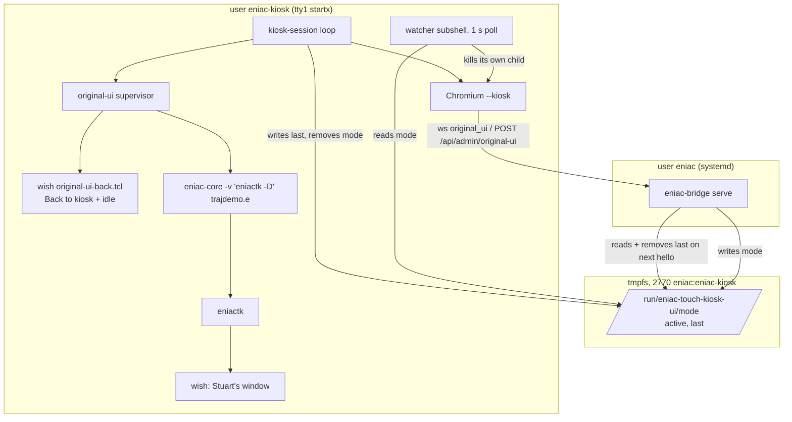
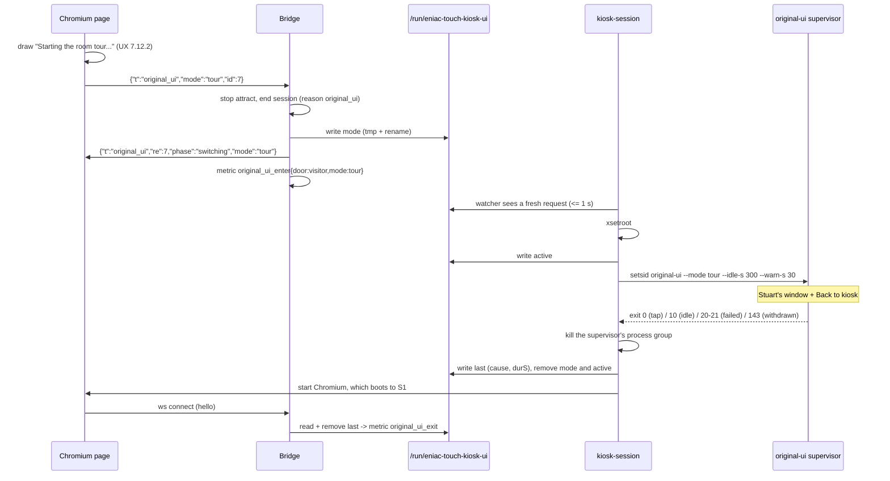

# Original UI switch: staff switch and visitor room tour

**Version:** 0.1
**Last Updated:** 2026-10-07
**Author:** Nick DeMarco with AI assistance (software-architecture agent)
**Status:** Draft. Every decision was made while Nick was unattended at the museum; see section 12 for what he should confirm.
**Inputs:** `~/Workspaces/vcf/outputs/2026-10-07-eniac-kiosk/original-ui-switch-brief.md`; Nick's second ask, the same day: a visitor-facing button for Stuart's original room tour; `docs/ux-spec.md` 7.11 and 7.12 (screens, copy, sizes, idle values; UX owns those); `docs/architecture.md` 3.5, 5.6, 8.4 and 10.5.
**Grounding:** I read the upstream tree at the pinned commit `c4b94f2` (`build/upstream`, with our three patches applied): `vis/eniactk.go`, `vis/Makefile`, `src/eniac.go` (`main`, the `D` command), `src/engine.go` (`enginedisplay`), `programs/trajdemo.e` and `images/`. I also read the legacy trial `scripts/eniac-try.sh`, which is how the museum's old Pi ran it.

This document gives the developer every decision needed to build the feature: file names, config keys, message names, endpoints, timeouts and exit codes. UX 7.12 gives the screens and the copy. Where the two overlap, UX 7.12 wins on wording and layout and this document wins on mechanism.

---

## 1. Summary

Brian L. Stuart's original front end, `eniactk`, is an X11/Tk desktop app, not a web page. "Bringing it back" therefore means swapping it for Chromium on the same X display, then swapping back.

- **Two ways in.** Staff: the 5-tap corner, then the S12 PIN pad, then S13 Admin, then **Original UI**, which starts the interactive front end. Visitors: the **Original room tour** tile in Explore (UX 7.12.4), which starts the self-running `-D` tour. No PIN is needed for the tour.
- **One way out.** An always-on-top **Back to kiosk** button (280 x 96, top left) drawn by our own small `wish` script. There is also an idle timeout: 5 min on the tour, 15 min in interactive mode, each with a 30 s countdown on the button.
- **The mechanism.** The bridge writes a one-line request file into a tmpfs directory shared by the two users. The kiosk session loop sees it within 1 s, closes its own Chromium and runs the original-UI supervisor. When the supervisor exits, the loop deletes the request and starts Chromium again, which lands on S1. No process ever signals another user's processes. Nothing survives a reboot.
- **The same simulator.** The original UI runs **our** `bin/eniac-core`, built from the same pinned commit and patches. Patch 0001 is the fix for a crash that the unpatched core causes in eniactk. `eniactk` is built from the same export. The release adds `original-ui/` with eniactk, two image sizes and links to `upstream/programs`. The installer adds the `tk` package. xterm is not needed.
- **Prerequisite work.** Today's admin zone only calls `startOver()`, and the bridge has no admin endpoints. This feature therefore also builds the 5-tap counter, S12, a three-button S13, the admin login and the `restart-core` action (section 6).

## 2. Upstream facts this design rests on

| # | Fact | Evidence | Consequence |
|---|---|---|---|
| O1 | `-D` is an **eniactk** flag ("cycle among perspectives"). It is not a core flag. Every 5 s it steps Perspective, S1, S2, S3, S4, S5, so one full cycle takes **30 s**. It changes the view only. The program runs as the `.e` file says. | `vis/eniactk.go:265`, `rundemo()` at `:878`. `src/eniac.go` `main` takes only `-v` (and `-c` on arm). The core's `D` is a stdin dump command. | The brief's `src/eniac -D programs/trajdemo.e` is a mis-transcription. The real command, from `scripts/eniac-try.sh:31`, is `tail -f /dev/null \| src/eniac -v "vis/eniactk -D" trajdemo.e`. This answers UX Q30: the 5 min tour limit covers about 10 full cycles. |
| O2 | `programs/trajdemo.e` (with `drag.e`, and `demo.card` read through `f r demo.card` relative to the cwd) is in the pinned tree. Its last lines `b c` / `b r` / `b i` start the run on load. | `trajdemo.e:22,839-841` | Both modes load `trajdemo.e`, so the machine is already running when the window appears. Staff can load other programs with Stuart's LOAD CONF menu. |
| O3 | eniactk is one file of standard-library Go (`bufio flag fmt io os os/exec runtime sort strconv strings time`). It runs `wish` from `PATH` and writes Tcl to it. | imports; `innergui()` `exec.Command("wish")` | Cross-compile it like the core (`CGO_ENABLED=0`). The box needs `/usr/bin/wish`, from apt package `tk`. |
| O4 | eniactk looks for `images/` in its cwd, then `../images`. It lists `programs/` in the cwd for LOAD CONF. It picks the image width from the screen size: on 1920x1080 it uses **1900** (`e1900*.ppm`); on 1366x768 it would use 1280. It also loads `control.ppm`, `orange.ppm`, `orange2.ppm` or `orange3.ppm`, `gpilot.ppm` and `apilot.ppm`. | `findimages()`, `innergui()` | cwd = `<release>/original-ui`, which holds `images/` and a `programs` link. `images/` is 285 MB in total, but widths 1280 and 1900 plus the fixed sprites come to about 47 MB. |
| O5 | The core reads stdin until EOF and then **exits**. It splits its `-v` argument on single spaces. | `src/eniac.go` `main`; `engine.go:49` | Hold stdin open with `tail -f /dev/null \|`, as the trial did. Paths must not contain spaces; release paths never do. |
| O6 | eniactk uses handshake mode (`update`), which busy-spins one CPU core when nothing changes (architecture U4). | `innergui()` prints `update` | This is acceptable for a bounded visit on a 4-core i5, with Chromium gone. The supervisor runs the core at `GOMAXPROCS=2`, `nice 5`. |
| O7 | Its window is `wm geometry . +5+5`, 1900 x 1070 on this panel. Its controls are in the bottom band (CLEAR/READ/INIT/PULSE and RESET/LOAD CONF bottom left, S1 to S5 and Perspective along the bottom). The **LOAD CONF menu pops up at screen (10,10)** as an override-redirect menu. | `innergui()`, `loadmenu()` | The top left 280 x 96 is photograph only, so the Back button can sit there (UX Q29). The Back button must **not** be re-raised on a timer: that would cover the LOAD CONF menu. Section 5.3 covers this. |
| O8 | With openbox's default config, Tk's window gets a title bar with close and minimise buttons. Closing the window kills `wish` but leaves eniactk and the core running headless behind a black screen. | Default openbox `rc.xml` | We ship an openbox config with no decorations (ADR-OUI-10). The supervisor also watches for eniactk dying (5.2). |

## 3. Architecture

### 3.1 Process view



### 3.2 Sequence: visitor tour, round trip



## 4. The request directory and file formats

**Directory:** `/run/eniac-touch-kiosk-ui`, owner `eniac`, group `eniac-kiosk`, mode **2770** (setgid, so files the bridge creates belong to group `eniac-kiosk`). It is created at boot by `/etc/tmpfiles.d/eniac-touch-kiosk.conf`, which the installer writes:

```
# Written by eniac-touch-kiosk install.sh; removed by its uninstaller.
# Original-UI switch requests between the bridge (eniac) and the kiosk session (eniac-kiosk).
d /run/eniac-touch-kiosk-ui 2770 eniac eniac-kiosk -
```

The installer runs `systemd-tmpfiles --create /etc/tmpfiles.d/eniac-touch-kiosk.conf` so the directory exists without a reboot. The bridge unit gains `ReadWritePaths=-/run/eniac-touch-kiosk-ui`. The leading `-` keeps the unit starting if the directory is missing, in which case the feature reports itself unavailable. Config key: `paths.uiSwitch`.

All three files are one line of space-separated `key=value` pairs, so bash can parse them without tools. Writers always write `<name>.tmp` and then `rename`.

| File | Writer | Reader | Content | Lifetime |
|---|---|---|---|---|
| `mode` | bridge (`uiswitch.Request`), or `eniac-bridge ui-request` over SSH | kiosk-session | `mode=tour id=3f9a1c2e at=1759851234 idleS=300 warnS=30 ttlS=10 door=visitor` | From the request until the original UI exits. Removed by kiosk-session, by the bridge if stale, or by `ui-request --mode off`. |
| `active` | kiosk-session | bridge (`/healthz`, `available`) | `mode=tour id=3f9a1c2e since=1759851235` | While the original UI runs |
| `last` | kiosk-session | bridge (on the next ws `hello`) | `mode=tour door=visitor id=3f9a1c2e cause=idle durS=301` | Until the bridge records the metric and deletes it |

Field rules: `mode` is `tour` or `interactive`. `id` is 8 lowercase hex characters. `at`, `since` and `durS` are integer seconds since the epoch, or a count of seconds. `idleS` is 60 to 7200. `warnS` is 0 to 120 and less than `idleS`. `ttlS` is 1 to 60. `door` is `visitor`, `staff` or `remote`. `cause` is `tap`, `idle`, `failed` or `remote`. A `mode` file that fails these rules is logged and deleted, and Chromium stays.

**A request is fresh** if `now - at <= ttlS` (default 10 s). kiosk-session acts only on fresh requests and deletes stale ones. This means a request the session never saw (X was down, or an old kiosk-session without the watcher was running) can never fire later. The UI's 15 s failure page (UX 7.12.2) is therefore always truthful: after 15 s the request has expired and nothing will switch.

## 5. The kiosk session side

### 5.1 `deploy/kiosk/kiosk-session` changes

New settings, with environment overrides that exist as test seams:

```bash
UI_DIR="${KIOSK_UI_DIR:-/run/eniac-touch-kiosk-ui}"
ORIGINAL_UI="${KIOSK_ORIGINAL_UI:-$HERE/original-ui}"
PLATE='#0E0F11'
```

1. **At session start:** `xsetroot -solid "$PLATE"` (from `x11-xserver-utils`, already installed). Then run openbox with our config: `openbox --config-file "$HERE/openbox-rc.xml" &` (ADR-OUI-10).
2. **`read_request`**: parses `$UI_DIR/mode` into `REQ_MODE REQ_ID REQ_AT REQ_IDLE REQ_WARN REQ_TTL REQ_DOOR`. It returns 1 if the file is missing. An invalid file is logged, deleted, and also returns 1. `request_fresh` checks `$(date +%s) - REQ_AT <= REQ_TTL`.
3. **At the top of each loop iteration:** if `read_request` succeeds:
   - fresh: `run_original_ui`, then `continue` with no 3 s sleep;
   - stale: log `ui: stale request $REQ_ID ignored (age Ns)`, `rm -f "$UI_DIR/mode"`, and fall through to Chromium.
4. **Chromium launch** changes from a foreground pipeline to a background job, so the loop knows its PID:
   ```bash
   "$BROWSER" "${FLAGS[@]}" --user-data-dir="$PROFILE" --kiosk --app="$KIOSK_URL" \
     > >(logger -t eniac-touch-kiosk-chromium 2>/dev/null) 2>&1 &
   CPID=$!
   watch_chromium "$CPID" & WPID=$!
   wait "$CPID"; rc=$?
   kill "$WPID" 2>/dev/null; wait "$WPID" 2>/dev/null
   ```
   `watch_chromium` loops while `kill -0 $CPID`. Every **1 s** it checks for a fresh request. When it finds one it logs `ui: $REQ_MODE requested ($REQ_ID, door $REQ_DOOR); closing Chromium`, runs `xsetroot -solid "$PLATE"`, sends `kill -TERM $CPID`, waits up to 5 s, then sends `kill -KILL $CPID`, touches `$PROFILE_ROOT/.ui-switch` and exits. After `wait`, if `.ui-switch` exists the loop removes it and skips the `sleep 3`. Otherwise the existing "chromium exited; restarting in 3 s" path runs.
5. **`run_original_ui`**:
   ```bash
   started=$(date +%s)
   printf 'mode=%s id=%s since=%s\n' "$REQ_MODE" "$REQ_ID" "$started" > "$UI_DIR/active.tmp" && mv -f "$UI_DIR/active.tmp" "$UI_DIR/active"
   log "ui: starting original UI ($REQ_MODE, $REQ_ID, idle ${REQ_IDLE}s)"
   setsid "$ORIGINAL_UI" --mode "$REQ_MODE" --idle-s "$REQ_IDLE" --warn-s "$REQ_WARN" \
     > >(logger -t eniac-touch-kiosk-original-ui 2>/dev/null) 2>&1 &
   OPID=$!                         # no job control: setsid execs in place, so pgid == OPID
   watch_withdrawal "$OPID" "$REQ_ID" & WPID=$!
   wait "$OPID"; rc=$?
   kill "$WPID" 2>/dev/null; wait "$WPID" 2>/dev/null
   kill -TERM -- "-$OPID" 2>/dev/null; sleep 1; kill -KILL -- "-$OPID" 2>/dev/null   # core, eniactk, both wish
   case "$rc" in 0) cause=tap ;; 10) cause=idle ;; 143|137) cause=remote ;; *) cause=failed ;; esac
   dur=$(( $(date +%s) - started ))
   printf 'mode=%s door=%s id=%s cause=%s durS=%s\n' "$REQ_MODE" "$REQ_DOOR" "$REQ_ID" "$cause" "$dur" > "$UI_DIR/last.tmp" && mv -f "$UI_DIR/last.tmp" "$UI_DIR/last"
   rm -f "$UI_DIR/mode" "$UI_DIR/active"
   log "ui: original UI ended ($cause, rc $rc, ${dur}s); back to the kiosk"
   ```
   `watch_withdrawal` polls every 1 s. If `mode` is gone or its `id` changed (an SSH `ui-request --mode off`, or a new request), it logs `ui: request withdrawn` and sends `kill -TERM $OPID`, which ends the wait with 143 (`remote`).
6. **The order of the guarantees:** the request is always removed after the original UI ends, whatever the cause, so the loop can never repeat it. A failed start (exit 20) comes straight back to Chromium.

### 5.2 `deploy/kiosk/original-ui` (new, bash): the supervisor

```
original-ui --mode tour|interactive --idle-s N --warn-s N
```

1. `HERE` is `deploy/kiosk`, `REL` is `$HERE/../..`, `OUI=$REL/original-ui`, `CORE=$REL/bin/eniac-core`, `WISH=${KIOSK_WISH:-/usr/bin/wish}`.
2. **Preflight** (exit **20** with one log line naming the missing piece): `$CORE`, `$OUI/bin/eniactk` and `$WISH` are executable; `$OUI/programs/trajdemo.e` and `$OUI/demo.card` are readable. Read the screen size with `xrandr --current` (the `current W x H` field) and apply eniactk's own rule: if `W/2+120 > H`, then `W = (H-120)*2`; take the largest entry of `480 720 1020 1280 1360 1600 1800 1900 2500 3500` that is less than W, defaulting to 1900. Then `$OUI/images/e${width}.ppm` must exist. On the OptiPlex panel the width is 1900.
3. `cd "$OUI"`. Set `flag=" -D"` for tour mode and `flag=""` for interactive.
4. Start the simulator exactly as the old Pi did, but on our core:
   `tail -f /dev/null | GOMAXPROCS=2 nice -n 5 "$CORE" -v "$OUI/bin/eniactk$flag" trajdemo.e &`, then `COREPID=$!`.
5. Start the Back button: `"$WISH" "$HERE/original-ui-back.tcl" --idle-s N --warn-s N &`, then `BACKPID=$!`.
6. Supervise every 1 s:
   - Back exited: `wait $BACKPID`, then exit with its code (0 = tap, 10 = idle, anything else becomes 21).
   - The core is gone, or no `eniactk` child of `$COREPID` exists (`pgrep -P "$COREPID" -x eniactk`) after a 5 s start grace: log `core or eniactk exited`, exit **21**.
7. The supervisor never cleans up its children itself. kiosk-session kills the whole process group (5.1 step 5). On SIGTERM bash's default action exits 143.

| Exit | Meaning | `cause` |
|---|---|---|
| 0 | Back to kiosk tapped | `tap` |
| 10 | Idle timeout | `idle` |
| 20 | Preflight failed (no wish, no eniactk, no images for this screen width) | `failed` |
| 21 | Core, eniactk or the Back window died | `failed` |
| 143 / 137 | Withdrawn (SSH `off`) or killed | `remote` |

### 5.3 `deploy/kiosk/original-ui-back.tcl` (new, wish): Back to kiosk + idle

This follows UX 7.12.5 and 7.12.6 for size, copy and colours.

- `wm title . eniac-back`, `wm geometry . 280x96+0+0`, `wm resizable . 0 0`, `wm attributes . -topmost 1`. openbox puts it in the **above** layer (ADR-OUI-10). Focus is refused: `. configure -takefocus 0`, plus `<focus>no</focus>` in the openbox config. There is **no** periodic `raise`, so Stuart's LOAD CONF menu (override-redirect, popped up at 10,10) can draw over the button while it is open (O7).
- The window background is `#0E0F11` with a 3 px `#F0E442` border (`-highlightthickness 3`). A label reads **Back to kiosk** in font `{DejaVu Sans} -32 bold` (negative size = pixels), text colour `#F4EFE3`.
- Bindings sit on the toplevel, so they cover the label too. `<ButtonPress-1>` sets the fill to `#1B1D21`. `<ButtonRelease-1>` changes the label to **Going back...**, removes the bindings, runs `update idletasks`, then `after 150 {exit 0}`. There are no key bindings.
- Idle: `tick` runs every 500 ms. `idleMs = [tk inactive]`, which is the X server's time since the last input event on any window (XScreenSaver extension; Ubuntu's tk8.6 links libXss). If it returns `-1` (unsupported), the script logs it once to stderr and counts from its own start time instead. Then `remain = idleS - idleMs/1000`:
  - `remain <= warnS`: label **Back to kiosk 0:SS** (`m:ss`), border toggling between `#F0E442` and `#0E0F11` at 1 Hz;
  - otherwise the normal label (this restores it if a touch comes in during the warning);
  - `remain <= 0`: label **Going back...**, `exit 10`.
- Strings are hard-coded in the script, using the UX 7.12.7 `originalUi.back*` keys as comments, because the wrapper is not the web app.

### 5.4 `deploy/kiosk/openbox-rc.xml` (new)

This is a minimal openbox config, passed with `--config-file`. It never writes to `/etc/xdg/openbox`.

- `<applications>`: `<application class="*"><decor>no</decor><maximized>no</maximized></application>` (no title bars, so no close or minimise buttons reachable by touch), and `<application title="eniac-back"><decor>no</decor><layer>above</layer><focus>no</focus><position force="yes"><x>0</x><y>0</y></position></application>`.
- `<keyboard>` and `<mouse>` are left empty except for `<context name="Client"><mousebind button="Left" action="Press"><action name="Focus"/></mousebind></context>`. This removes the root-window menu, Alt+Tab and window dragging.
- Chromium in `--kiosk` is fullscreen and undecorated anyway, so the kiosk side looks the same.

## 6. Bridge and web: admin, PIN, protocol

### 6.1 Admin API (HTTP, loopback listener only)

This implements architecture 8.4 for v1. The base is `http://127.0.0.1:8740`, on the same listener as `/ws`. Every admin route requires `Origin` to be one of the ws origins, `Content-Type: application/json` and a body of at most 1 KB. Otherwise it returns 403 or 400. Errors use the 5.4 error body `{"error":{"code":"…","message":"…"}}`.

| Method + path | Body | Success | Errors |
|---|---|---|---|
| `POST /api/admin/login` | `{"pin":"123456"}` (4 to 8 digits) | 200 `{"token":"<32 hex>","expiresInS":600}` | 401 `BAD_PIN` (sent after a fixed **2 s** delay); 429 `LOCKED` `{"retryAfterS":N}` after **5** failures in 5 min, for **60 s**; 503 `NO_PIN` if the PIN file is missing or unreadable |
| `POST /api/admin/logout` | `{}` | 204 | none |
| `POST /api/admin/restart-core` | `{}` | 200 `{"ok":true}`. It stops attract, ends any session (reason `restart`) and resets the recovery budget. If the core is in the final `E-RETRY-BUDGET` state, it starts a probe now. The UI then shows S1, and attract starts a fresh core. | 401 `TOKEN` |
| `POST /api/admin/original-ui` | `{}` | 202 `{"ok":true,"mode":"interactive","id":"3f9a1c2e"}`. It stops attract, ends the session (reason `original_ui`) and writes the `mode` request with `door=staff`, `idleS=originalUi.interactiveIdleS`. | 401 `TOKEN`; 409 `UNAVAILABLE` `{"reason":"…"}`; 429 `BUSY` (a request is already pending or running) |

- **Token:** one active token. A new login replaces it. It expires **600 s after login** (`admin.tokenTtlS`), which is an absolute lifetime, not idle-based. The 2-minute S13 idle exit (FR-74) is client-side: S13 calls `logout` when it exits. If a request returns 401, the UI goes back to S12.
- **No `return-to-kiosk` endpoint.** "Return to kiosk" on S13 is UI-only (logout, then go back). While the original UI is up, Chromium is not running, so nothing could call such an endpoint anyway. The return from the original UI is the Back button, the idle timeout, or `ui-request --mode off` over SSH.
- **Not in v1:** `restart-app`, `reboot`, `shutdown`, `update`, `rollback`, health tiles and metrics. These stay M3, and their routes return 404 until they are built.

### 6.2 PIN

- **Storage:** `/etc/eniac-touch-kiosk/admin-pin` holds one bcrypt hash (cost 10), owner `root:eniac`, mode **0640**. It is never in config.yaml (which is 0644 and comes from the repo) and never in the repo (NFR-10). Config key: `admin.pinFile`. The bridge reads it on every login attempt, so a change applies at once with no restart.
- **No default PIN** (NFR-10: "no default credentials"). If the file is missing, login returns `NO_PIN`, and S12 shows "No staff PIN is set on this kiosk." The visitor tour does not need a PIN, so it works either way.
- **Setting and changing it:** `sudo eniac-touch-kiosk set-pin` prompts twice without echo. `sudo eniac-touch-kiosk set-pin --stdin` reads one line, for scripted setup. Both check the PIN is 4 to 8 digits and pipe it to `eniac-bridge pin-hash` (a new subcommand: reads stdin, prints the bcrypt hash; dependency `golang.org/x/crypto/bcrypt`). They then write the file atomically with `install -m 0640 -o root -g eniac`. `install.sh` prompts for a PIN only when stdin is a TTY **and** the file does not exist. With `--no-pin` or no TTY it skips the prompt and prints a reminder to run `set-pin`.
- **Museum install:** the deploy steps (section 10) generate a random 6-digit PIN on the Mac, set it with `--stdin`, and give it to Nick privately. Floor staff cannot change the PIN without SSH in v1 (open question Q-OUI-3).

### 6.3 Websocket: the visitor door

The visitor tour does not go through the PIN, so it uses the websocket whitelist (5.6) like every other visitor intent. HTTP stays for authenticated admin actions only, matching the existing `admin_*` row of 5.6.

**Client to server, a new whitelist row:**

| `t` | Fields | Allowed in | Bridge action | M |
|---|---|---|---|---|
| `original_ui` | `mode`: `"tour"` (the only value) | any | If `originalUi.enabled` and `available`: stop attract, end any session (reason `original_ui`), write the request (`door=visitor`, `idleS=originalUi.tourIdleS`), reply `original_ui {phase:"switching"}`, and record `original_ui_enter`. Otherwise reply `error` `NOT_ALLOWED` with the reason. A second request while one is pending or running, or within `originalUi.minGapS` (10 s) of the last, replies `switching` again with the same `id` and writes nothing. | M3-lite |

`protocol.Decode` accepts `{"t":"original_ui","mode":"tour"}` with an optional `id`. Any other `mode` (in particular `"interactive"`) or any extra field is `BAD_MESSAGE`. The interactive mode is only reachable through the PIN.

**Server to client:**

| `t` | When | Payload |
|---|---|---|
| `original_ui` | Reply to `original_ui` | `re`, `phase`: `"switching"`, `mode`: `"tour"`, `id` (request id). The page has already drawn the switching screen (UX 7.12.2). It expects to be killed within about 1 to 2 s and shows the failure state at 15 s. |
| `hello` (extended) | On connect | `config.originalUi = {available: bool, reason?: string, tourIdleS, interactiveIdleS}`. The visitor tile is drawn only if `available` (UX 7.12.4). S13 draws **Original UI** disabled with "Not installed on this box." if it is false (UX 7.12.2). UX's "`/health` field `originalUi`" means this field. |

**`available` is computed** at startup and on every `hello` (all cheap `stat` calls). It is false, with a reason, when any of these hold: `originalUi.enabled: false` (`disabled`); `paths.uiSwitch` missing or not writable (`no-switch-dir`); `<release>/original-ui/bin/eniactk` missing (`not-built`); `originalUi.wish` (`/usr/bin/wish`) missing (`no-tk`); or the `active` file exists (`running`, only reachable over SSH).

### 6.4 `/healthz` additions

```json
"originalUi": {"available": true, "reason": "", "active": {"mode": "tour", "id": "3f9a1c2e", "sinceS": 42}}
```

`active` is `null` when no `active` file exists. This lets Nick see over SSH or LAN which UI is on screen. **Note for M3:** the planned "kiosk client silent for 60 s means restart the display" rule (5.8) **must skip** while `active` is set, or it would kill the original UI.

### 6.5 Metrics (bridge-written, `NOT_ALLOWED` from the UI)

| Event | Fields | Written when |
|---|---|---|
| `original_ui_enter` | `door` (`visitor`/`staff`/`remote`), `mode` (`tour`/`interactive`) | The bridge or `ui-request` writes a request |
| `original_ui_exit` | `door`, `mode`, `cause` (`tap`/`idle`/`failed`/`remote`), `durS` | The bridge reads `last` on the next ws `hello`, then deletes it. It is recorded once even across bridge restarts, because the file is deleted. |
| `admin_login` | `ok` (bool), `locked` (bool, only on 429) | Each login attempt (never the PIN) |
| `admin_action` | `action` (`restart-core`/`original-ui`) | Each authenticated action |

These names follow UX 7.12.6 (`original_ui_enter` with door, `original_ui_exit` with cause). The `metric` decoder's bridge-only list gains all four. `session_end.reason` gains `original_ui`.

**Journal lines** (bridge `slog`, unit `eniac-touch-kiosk-bridge`): `ui: switch requested` (mode, door, id), `ui: switch refused` (reason), `ui: stale request removed` (id, ageS), `ui: original UI ended` (mode, cause, durS), `admin: login` (ok, locked), `admin: action` (name). Session tags: `eniac-touch-kiosk-session` (switch, stale, ended), and a new tag `eniac-touch-kiosk-original-ui` for the supervisor, core, eniactk and wish output. `eniac-touch-kiosk logs` adds `-t eniac-touch-kiosk-original-ui`.

### 6.6 Config (`/etc/eniac-touch-kiosk/config.yaml`, and `internal/config`)

```yaml
admin: { sessionTimeoutS: 120, allowPowerActions: false, allowUpdates: false,
         pinFile: /etc/eniac-touch-kiosk/admin-pin, tokenTtlS: 600 }
originalUi:
  enabled: true
  tourIdleS: 300          # visitor -D tour (UX 7.12.6)
  interactiveIdleS: 900   # staff interactive (UX 7.12.6)
  warnS: 30               # countdown on the Back button
  requestTtlS: 10         # kiosk-session ignores older requests
  minGapS: 10             # repeat requests within this window are no-ops
  wish: /usr/bin/wish
paths:
  uiSwitch: /run/eniac-touch-kiosk-ui
  originalUi: /opt/eniac-touch-kiosk/current/original-ui   # default <release>/original-ui
```

- `Default()`: `originalUi.enabled: false` (the dev, test and Model 4 profiles don't have it). `deploy/kiosk/config.yaml` sets it to `true`. Validation: `60 <= tourIdleS, interactiveIdleS <= 7200`; `0 <= warnS < min(idle)`; `1 <= requestTtlS <= 60`; `minGapS >= 0`; `paths.uiSwitch` and `paths.originalUi` contain no spaces; `admin.tokenTtlS` from 60 to 3600.
- **The box's config.yaml was installed from the old release and is never overwritten.** The `KnownFields(true)` decoder only rejects unknown keys; a missing `originalUi` block just takes the defaults, and the defaults leave the feature **off**. The deploy steps add the block by hand (10, step 5). Alternatively the installer can append it when the existing file has no `originalUi:` key, which is the developer's choice and must be recorded in the PR. Recommended: the installer appends the block **once**, with a comment, and logs it, because staff must not need to edit YAML.

### 6.7 Web UI

- **Tap counter** (`src/web/app/admin/tapcount.ts`, pure, unit-tested): counts `pointerdown`s inside the zone from `hello.config.admin.tapZone` (`taps: 5`) within **3 s** from the first tap. Any `pointerdown` outside the zone resets it (a capture-phase listener on the app root). The fifth tap opens S12.
- **Living with today's single-tap Start over:** the first tap still runs `startOver()` at once (immediate feedback, UX-08). `#admin-zone` gets a `z-index` above `.scrim` and the confirm panel, so taps 2 to 5 still reach the zone. On the fifth tap the open Start-over confirm is dismissed as "No" and S12 opens. On screens where `startOver()` does nothing (S1, boot, error), the count works just the same (UX 7.11: "works on every screen including S10").
- **S12** (`src/web/app/screens/pin.ts`): as UX 7.11, with a 3 x 4 pad. The bottom row is **Clear**, **0**, **OK**. **OK** posts to `login`. The responses map as follows: `BAD_PIN` shows "Not right" for 1 s, then the visitor screen; `LOCKED` shows "Try again in a minute." for 2 s, then the visitor screen; `NO_PIN` shows "No staff PIN is set on this kiosk." for 3 s, then the visitor screen. 30 s idle returns to the visitor screen. New copy keys: `admin.pin.locked` and `admin.pin.none`.
- **S13** (`src/web/app/screens/admin.ts`): exactly the three buttons and the header of UX 7.12.2: **Restart simulator** (`POST restart-core`, then `logout`, then S1), **Original UI** (the confirm panel from UX 7.12.2, then the switching page, then `POST original-ui`), and **Return to kiosk** (`logout`, then the previous screen or S1). Exits in 2:00 (FR-74).
- **Switching page** (`src/web/app/screens/switching.ts`): UX 7.12.2. It is drawn **before** the request is sent, shows no buttons, and shows the failure state at 15 s with one button. A `NOT_ALLOWED` or HTTP error reply shows the failure state at once.
- **Explore tile** (`src/web/app/screens/explore.ts`, rail state A): UX 7.12.4. It is drawn only if `hello.config.originalUi.available`. It sends `{"t":"original_ui","mode":"tour"}`.
- **API client** (`src/web/app/net/api.ts`): `adminLogin(pin)`, `adminLogout(token)`, `adminAction(token, "restart-core"|"original-ui")`.
- **Types:** add `OriginalUI` (client) and `OriginalUIReply` (server), and `HelloConfig.originalUi`, to `internal/protocol`, then regenerate `protocol.gen.ts`.
- **Copy:** all the UX 7.12.7 keys plus the two S12 keys above, in `copy.ts`.

### 6.8 SSH control (for Nick and the runbook)

`eniac-touch-kiosk original-ui tour|interactive|off|status` (sudo) runs `runuser -u eniac -- eniac-bridge ui-request --config /etc/eniac-touch-kiosk/config.yaml --mode <m>`. This new subcommand uses the same `uiswitch` code and config with `door=remote`. `off` deletes `mode`, and the session's withdrawal watcher closes the original UI. `status` prints the three files. This is the remote way back if the touch screen fails.

## 7. Build and release

### 7.1 `scripts/fetch-upstream.sh`

After `build_core`, add `build_eniactk <src> <goos> <goarch> <out>`:
`cd "$src" && CGO_ENABLED=0 GOTOOLCHAIN=$TOOLCHAIN GOFLAGS=-mod=mod GOOS=… GOARCH=… go build -trimpath -o "$out" ./vis/eniactk.go`.
Build it for `linux/arm64`, `linux/amd64` and the host, into `build/<os>-<arch>/eniactk`. It comes from the same patched export, so the eniactk and core sources are the same commit. `.provenance.json` gains `"originalUi":{"eniactk":"vis/eniactk.go"}`.

### 7.2 `scripts/build-release.sh`

- Require `build/linux-$ARCH/eniactk` and check it is a static ELF for the target, like the other binaries.
- Stage `original-ui/`:
  ```
  original-ui/bin/eniactk
  original-ui/images/{e<W>.ppm,e<W>s1..s5.ppm for W in $ORIGINAL_UI_WIDTHS, control.ppm, orange.ppm, orange2.ppm, orange3.ppm, gpilot.ppm, apilot.ppm}
  original-ui/programs  -> ../upstream/programs      (relative symlink)
  original-ui/<each>.card -> ../upstream/<each>.card  (relative symlinks; trajdemo opens demo.card)
  ```
  `ORIGINAL_UI_WIDTHS` defaults to `"1280 1900"` (about 47 MB uncompressed; check the compressed size and record it in the PR). Fail the build if any listed image is missing.
- Copy `deploy/kiosk/{original-ui,original-ui-back.tcl,openbox-rc.xml}`. They are already inside `deploy/kiosk`, which is copied whole. Make sure `original-ui` is mode 0755.
- `SHA256SUMS` already covers regular files only, and the symlinks are relative inside the release, so `install.sh`'s `cp -a` keeps them.
- `BUILD-INFO` gains `originalUi=1`.

### 7.3 `deploy/kiosk/install.sh`

- Add `tk` to the apt line (`… openbox unclutter tk`). It is recorded in the manifest through the existing package diff and removed by `--purge-packages`. Also add `tk` to `PKGS_X` in `scripts/stick/offline-repo.sh` so the one-stick install carries it.
- Write `/etc/tmpfiles.d/eniac-touch-kiosk.conf` (section 4), `record file` it, and run `systemd-tmpfiles --create` on it.
- The unit file gains `ReadWritePaths=-/run/eniac-touch-kiosk-ui` (this is in `deploy/kiosk/eniac-touch-kiosk-bridge.service`, installed as usual).
- PIN prompt as in 6.2 (`--no-pin` to skip). Append the `originalUi:` block to an existing config.yaml that lacks it (6.6).
- Preflight: `MIN_FREE_MB` stays at 300, which is enough. Add a check that `/usr/bin/wish` exists after apt when `DO_PACKAGES=1`, warning (not dying) if it is missing.
- `deploy/kiosk/uninstall.sh`: add the tmpfiles conf and `/etc/eniac-touch-kiosk/admin-pin` to `CANON_FILES`, `rm -rf /run/eniac-touch-kiosk-ui`, and add `tk*`, `tcl*`, `libtk*`, `libtcl*` and `libxss*` to the purge allow-list pattern if it has one.
- `deploy/kiosk/eniac-touch-kiosk`: subcommands `set-pin [--stdin]` and `original-ui tour|interactive|off|status`; extend `logs` and `status` (status prints the `active` line).

## 8. Test seams

| Seam | Where | Tests |
|---|---|---|
| `internal/uiswitch` (new) | `uiswitch.go`, `uiswitch_test.go` | `Request` writes `mode` atomically (no `.tmp` left behind), with the exact key order and mode 0640, in a `t.TempDir()`. It rejects modes other than `tour`/`interactive`. `minGapS` and pending/running make repeats return the same id with no new write. A stale request (injected clock) is replaced. `Available()` reasons: `disabled`, `no-switch-dir`, `not-built`, `no-tk` (injected `stat`/`LookPath`), `running`. `ConsumeLast()` parses, returns the exit and deletes the file; a malformed `last` is deleted and returns nothing. `Withdraw()` deletes `mode`. Parser fuzz: it never panics. |
| `internal/admin` (new) | `admin.go`, `admin_test.go` with `httptest` | Login ok returns a token. A bad PIN returns 401 after the injected 2 s sleeper. The fifth failure returns 429, `retryAfterS` counts down on the injected clock, and login works again after 60 s. A missing or unreadable PIN file returns 503 `NO_PIN`. A changed PIN file applies on the next login. Token expiry at `tokenTtlS`; a new login invalidates the old token; logout invalidates. Missing or foreign `Origin` returns 403; wrong method 405; oversized body 400. `original-ui` without a token returns 401; with one it calls `Switcher.Request(interactive, staff)` and the session stop hook, and returns 202. `UNAVAILABLE` returns 409. `restart-core` calls the session hook and the recovery reset. Metrics records never contain the PIN. |
| `protocol.Decode` | `decode_test.go` | `{"t":"original_ui","mode":"tour"}` is ok. `mode:"interactive"`, a missing mode and extra fields are `BAD_MESSAGE`. A `metric` with any of the four new bridge event names is rejected. |
| `session.Manager` | `session_test.go` (fakecore) | `original_ui` during attract stops the loop; during a mission it ends the session with reason `original_ui`. The reply is `switching`. `original_ui_enter` is recorded. When unavailable the reply is `NOT_ALLOWED` and nothing is written. A `last` file present at `hello` produces exactly one `original_ui_exit`. |
| `config` | `config_test.go` | Defaults (off), the deploy config (on), and every validation bound in 6.6. |
| Web pure modules | `tests/web/tapcount.test.ts`, `tests/web/pinpad.test.ts` | Five taps in 3 s open; a sixth-second tap or an outside touch resets; four taps then a pause does nothing. Pad: max 8 digits, Clear, OK disabled under 4. |
| Session loop | `tests/deploy/test-ui-switch.sh` (new, bash, no X) | Runs `kiosk-session` with `KIOSK_UI_DIR=$tmp`, `KIOSK_ORIGINAL_UI=<stub>`, a stub Chromium (`sleep 600`) via `BROWSER`/`PATH`, a stub `xsetroot` and a stub bridge port. Checks: (1) writing a fresh `mode` kills the stub Chromium within 2 s and starts the stub supervisor with the right arguments; (2) stub exit 10 gives `last` with `cause=idle`, removes `mode`/`active` and restarts Chromium with no 3 s sleep; (3) a stale `mode` is deleted and Chromium starts; (4) a malformed `mode` is deleted; (5) deleting `mode` while the stub runs gives `cause=remote`. It needs kiosk-session to honour `KIOSK_BROWSER` (new override) as well as the two `KIOSK_*` seams in 5.1. |
| Container (cheap addition) | `tests/deploy/test-install-container.sh` | After install: `dpkg -s tk`; `/usr/bin/wish` exists; `original-ui/bin/eniactk` is a static ELF; `original-ui/programs/trajdemo.e` and `original-ui/demo.card` resolve; `images/e1900.ppm` exists; the tmpfiles conf is present and `/run/eniac-touch-kiosk-ui` is `2770 eniac:eniac-kiosk`; the unit has `ReadWritePaths`. **Optional smoke if under 60 s:** install `xvfb` **inside the test container only**, then `xvfb-run -s '-screen 0 1920x1080x24' runuser -u eniac-kiosk -- …/original-ui --mode tour --idle-s 60 --warn-s 5` under a 75 s timeout. It must exit 10 (idle) and the log must show eniactk running, which proves wish, the images, the program load and `tk inactive` on a real X server. |
| On the box | section 10, step 7 | The manual checks a container can't do: touch, the overlay over Stuart's window, idle by touch, power cycle. |

## 9. Security notes

- The bridge gains no privilege. It writes one file into a directory it shares with the kiosk user. It never signals another user's process, so `NoNewPrivileges=yes` and `ProtectSystem=strict` stay as they are. Only `ReadWritePaths` widens, by one tmpfs directory.
- The kiosk user can delete and replace the bridge's request files. It already owns the screen, so this grants nothing new. The bridge treats `last` as untrusted input: it validates it strictly and records only whitelisted values.
- A visitor can open the tour without a PIN. It is a read-only view of a separate simulator. It ends the visitor's own session, has a 10 s rate limit, and is bounded by the 5 min idle timeout. Stuart's LOAD CONF and RESET buttons can only affect that separate simulator.
- The PIN hash is root-owned, readable by `eniac` only, and never logged. A 4 to 8 digit PIN is weak against offline attack whatever the hash; the 0640 file mode and the online lockout are the real protection. The PIN must be strengthened before M3 turns on `allowPowerActions` or `allowUpdates` (Q-OUI-3).

## 10. Deploy to the OptiPlex at 10.130.10.42

The box currently has release `0.1.0-dev+ge571048133`, installed by hand following `docs/deploy-x86.md`. SSH: `ssh -i ~/.ssh/kiosk_3280 vcfed@10.130.10.42`, with passwordless sudo. apt sources are https only, which already covers the xtradeb PPA (`ppa.launchpadcontent.net` is https). `tk` and `golang-go` are not installed, and the box needs no Go. These steps are for whoever deploys. The design session did not run them.

```bash
# --- 1. On the Mac: test and build ------------------------------------------
cd ~/Workspaces/eniac-touch-kiosk
make test                                   # Go, web, and tests/deploy/test-ui-switch.sh
tests/deploy/test-install-container.sh      # includes the original-ui checks (8)
make release ARCH=amd64
REL=$(ls -t dist/eniac-touch-kiosk-*-linux-amd64.tar.gz | head -1); echo "$REL"
tar tzf "$REL" | grep -E 'original-ui/(bin/eniactk|images/e1900.ppm)$'   # both must print
K="ssh -i $HOME/.ssh/kiosk_3280 vcfed@10.130.10.42"

# --- 2. Copy ------------------------------------------------------------------
scp -i ~/.ssh/kiosk_3280 "$REL" "$REL.sha256" vcfed@10.130.10.42:
$K "sha256sum -c $(basename "$REL").sha256"

# --- 3. Install WITH packages (adds tk; records it in the manifest) ------------
B=$(basename "$REL" .tar.gz)
$K "tar xzf $B.tar.gz && cd $B && sudo ./install.sh --no-pin"
#   expect: apt installs tk (+ tk8.6, tcl8.6, libxss1 ...), "selftest: ok squares:"
$K "command -v wish && ls -ld /run/eniac-touch-kiosk-ui"   # /usr/bin/wish ; drwxrws--- eniac eniac-kiosk

# --- 4. Staff PIN: random, set over stdin, never committed ---------------------
PIN=$(LC_ALL=C tr -dc 0-9 </dev/urandom | head -c6)
printf '%s\n' "$PIN" | $K "sudo eniac-touch-kiosk set-pin --stdin"
$K "sudo ls -l /etc/eniac-touch-kiosk/admin-pin"    # -rw-r----- root eniac
#   Give the PIN to Nick privately (to his own email address only). Never in the
#   repo, the wiki, a PR or a commit message (NFR-10).

# --- 5. Config: make sure the originalUi block is there ----------------------
$K "grep -n '^originalUi:' /etc/eniac-touch-kiosk/config.yaml || echo MISSING"
#   If MISSING (the installer didn't append it): copy the block from
#   /etc/eniac-touch-kiosk/config.yaml.dist, plus admin.pinFile/tokenTtlS and
#   paths.uiSwitch, with sudoedit; then: $K "sudo eniac-touch-kiosk restart"
$K "curl -s 127.0.0.1:8740/healthz | grep -o '\"originalUi\":{[^}]*'"
#   expect "available":true

# --- 6. New X session (new kiosk-session + openbox config) -------------------
$K "sudo eniac-touch-kiosk restart-display"
sleep 15; $K "eniac-touch-kiosk status"            # Chromium kiosk running

# --- 7. Remote round trip (no touch needed) -----------------------------------
$K "sudo eniac-touch-kiosk original-ui tour"
sleep 8;  $K "pgrep -u eniac-kiosk -a eniactk; pgrep -u eniac-kiosk -a wish; eniac-touch-kiosk original-ui status"
#   expect: eniactk -D, two wish processes, an active line mode=tour
$K "journalctl -t eniac-touch-kiosk-original-ui -n 30 --no-pager"   # no "images" or "wish" errors
$K "sudo eniac-touch-kiosk original-ui off"
sleep 8;  $K "eniac-touch-kiosk status; pgrep -u eniac-kiosk eniactk || echo 'tk gone'"
```

**On the floor, by touch** (Nick, or anyone at the box). Each check notes what to look for:

1. Explore, then **Original room tour**: the switching page, then Stuart's window. The view changes every 5 s. **Back to kiosk** is at the top left and nothing important is under it (UX Q29). Tap it: "Going back..." appears and S1 follows within about 5 s.
2. Tour again, then hands off for 5 min. At 4:30 the button counts down `0:30`, and at 0:00 the kiosk returns to S1.
3. Five taps on the wordmark: the S12 PIN pad. Enter a wrong PIN: "Not right", then back to the visitor screen. Enter the right PIN: S13 with three buttons. Tap **Original UI**, then "Yes, switch": interactive Stuart window (no auto-cycling). Tap **LOAD CONF**: the menu draws over the Back button. Load `sq.e` and press INIT, then tap Back.
4. S13, then **Restart simulator**: S1, and attract restarts.
5. With the tour running, pull the power. It boots to the new kiosk (S1), never to the original UI.
6. `eniac-touch-kiosk logs` shows the matching `ui:` lines. After a few switches, the metrics for the month contain `original_ui_enter` and `original_ui_exit` records: `sudo tail /var/lib/eniac-touch-kiosk/metrics/$(date +%Y-%m).jsonl`.

**Rollback:** `sudo eniac-touch-kiosk rollback`. This puts back `0.1.0-dev+ge571048133`. Its kiosk-session has no watcher, so stale requests just expire (`ttlS`) and do nothing. The tmpfiles directory, the PIN file and the `tk` package stay in place and are harmless.

## 11. Architectural decision records

### ADR-OUI-1: Where the staff switch lives
**Status:** Accepted, 2026-10-07. **Decision:** a button **Original UI** on S13, between **Restart simulator** and **Return to kiosk** (UX 7.12.2). v1 builds S13 with only those three actions; health tiles, metrics and power/update actions stay M3. **Rejected:** a separate hidden gesture just for the original UI (a second secret to teach staff, and it skips the PIN); putting it on S10 (staff use it when nothing is broken).

### ADR-OUI-2: Swap the UI inside the one kiosk X session, driven by a request file
**Status:** Accepted. **Context:** eniactk is an X11/Tk app. Today the display has one start path (getty, startx, kiosk-session), and the bridge and the display run as different users. **Decision:** the bridge writes a request file. The kiosk-session loop runs the original UI in place of Chromium for one iteration. **Consequences:** (+) one start path, one X server, one supervisor, and boot-to-kiosk is unchanged; (+) failures fall back to Chromium naturally; (−) up to 1 s of polling latency, which is hidden behind the switching page. **Rejected:** (b) a second X session or user on another VT (two X servers fighting over one panel, VT switching needs root, and the touch mapping and blanking would have to be redone); the session polling the bridge over HTTP with bash `/dev/tcp` (it works, but it couples the display to bridge uptime and makes the return path depend on the bridge too).

### ADR-OUI-3: Requests do not survive reboot
**Status:** Accepted. **Decision:** the directory is on tmpfs (`/run`), and a request older than `ttlS` (10 s) is ignored and deleted. **Consequences:** a power cycle, the floor's universal recovery, always lands on the new kiosk, and a request missed for any reason can never fire later. **Rejected:** keeping it in `/var/lib/eniac-touch-kiosk` so the original UI could be "left on" across restarts. That would break boot-to-kiosk, and the idle timeout would undo it within 15 minutes anyway. If Nick wants an all-day original-UI mode, that is a different feature (Q-OUI-1).

### ADR-OUI-4: The session closes its own Chromium
**Status:** Accepted. **Decision:** a watcher subshell inside kiosk-session polls the request every 1 s and SIGTERMs the Chromium **it** started. **Consequences:** no cross-user signalling and no new privilege for the bridge. **Rejected:** the bridge running `pkill -u eniac-kiosk chromium` (needs root or a polkit/sudo rule, which `NoNewPrivileges=yes` forbids, and widens the bridge's power over the display); `eniac-touch-kiosk restart-display` (restarts X, 5 s or more of black, and needs root).

### ADR-OUI-5: A dedicated shared tmpfs directory
**Status:** Accepted. **Decision:** `/run/eniac-touch-kiosk-ui`, `2770 eniac:eniac-kiosk`, created by tmpfiles.d and opened to the bridge with `ReadWritePaths=-…`. **Rejected:** the bridge's own `RuntimeDirectory` (`0750 eniac`: the kiosk user can't read it, and systemd deletes it whenever the bridge restarts); adding `eniac-kiosk` to group `eniac` (it would expose `vlink.sock` and the session directories to the display user); world-writable `/tmp` (any process could forge a switch, and the bridge has `PrivateTmp=yes`).

### ADR-OUI-6: Returning by touch: our own Back button plus an idle timeout
**Status:** Accepted. **Decision:** a separate always-on-top `wish` window, 280 x 96 at the top left, labelled **Back to kiosk**, with no confirmation. Idle is measured by X input (`tk inactive`): 5 min for the tour, 15 min for interactive mode, with a 30 s countdown on the button. **Consequences:** discoverable, one tap, no new packages (wish comes with `tk`), and nothing injected into Stuart's window. **Rejected:** (ii) a corner-tap gesture (invisible to visitors, and it would collide with Stuart's own buttons since every tap also reaches Tk); (iii) timeout only (a visitor who is done is stuck for 5 minutes); `xprintidle` or `xdotool` (extra packages for what `tk inactive` already does). The brief suggested 10 min for staff; I followed UX 7.12.6 (15 min) because idle timing is UX's call and its reasons are stated. The Back button size also follows UX (280 x 96, not the brief's 120 x 96) so the label fits on one line.

### ADR-OUI-7: The same pinned core and patches; ship eniactk, not a second core
**Status:** Accepted. **Decision:** the original UI runs `<release>/bin/eniac-core`, the exact binary the kiosk uses. `eniactk` is built from the same verified, patched export by `fetch-upstream.sh`. **Consequences:** both UIs show the same simulator. Patch 0001 (`mult.go` `%2d`) is the fix for an **eniactk crash** (architecture 4.4), so running the original UI unpatched would bring that crash back. A bump of `upstream.lock` moves both UIs together. **Rejected:** building Stuart's `HEAD` separately (two simulators on one exhibit, and unreviewed upstream changes on the floor); building on the box (no Go toolchain there, and ADR-006).

### ADR-OUI-8: Launch without xterm
**Status:** Accepted. **Decision:** `tail -f /dev/null | eniac-core -v "<eniactk>[ -D]" trajdemo.e`, with cwd `<release>/original-ui`, output to the journal. **Rejected:** `xterm -e …` as the old Pi did (a keyboard-focused terminal window a visitor could see or close, plus another package; the terminal only kept stdin open, and `tail` does that).

### ADR-OUI-9: Ship a subset of Stuart's photographs, only for the original UI
**Status:** Accepted, with an open licence question. **Decision:** `original-ui/images/` holds widths 1280 and 1900 plus the fixed sprites (about 47 MB, not 285 MB), set by `ORIGINAL_UI_WIDTHS`. The supervisor refuses to start (exit 20, back to Chromium) if the screen needs a width that isn't shipped. **Consequences:** this is the first time upstream images leave the build machine in a release. Architecture 4.3 kept them out because of PRD R1 (no upstream licence). Releases stay private, and the museum's old Pi already held the whole upstream tree, so the exposure is the same as before. Nick should still confirm with Stuart (Q-OUI-2). **Rejected:** all widths (285 MB, 6x the release size); converting to PNG (would need an eniactk patch, which the 4.4 policy forbids for a non-bug).

### ADR-OUI-10: An openbox config with no decorations
**Status:** Accepted. **Decision:** kiosk-session runs `openbox --config-file <release>/deploy/kiosk/openbox-rc.xml`: no decorations, no key or mouse bindings, and `eniac-back` kept in the above layer at 0,0 without focus. **Consequences:** a visitor can't close or minimise Stuart's window into a black screen. The supervisor's eniactk watch is the backstop. **Rejected:** leaving the defaults (close and minimise one tap away, plus a root menu on long-press); Tk `overrideredirect` on the Back button (it would escape openbox's stacking, so it would need a periodic raise, which would cover Stuart's LOAD CONF menu).

### ADR-OUI-11: Admin over HTTP with a short-lived token; PIN as a bcrypt file with no default
**Status:** Accepted. **Decision:** `POST /api/admin/{login,logout,restart-core,original-ui}` on the loopback listener, as in 6.1. The token lasts 10 min from login. The PIN hash lives in `/etc/eniac-touch-kiosk/admin-pin` (0640 root:eniac). There is no default PIN, and it is set by `set-pin`. **Consequences:** this matches 5.6 (`admin_*` over HTTP), and the PIN never crosses the visitor websocket. **Rejected:** admin messages over the ws (mixes authenticated actions into the visitor whitelist, and every message would carry a token); the PIN in config.yaml, hashed or plain (0644 file, shipped from the repo); a default such as `1946` (violates NFR-10, and every visitor who knows ENIAC knows it); a plain-text PIN for v1 (no simpler for the code, and worse if the file leaks).

### ADR-OUI-12: The visitor door: `original_ui {mode:"tour"}` over the websocket, no PIN
**Status:** Accepted (Nick's second ask, 2026-10-07). **Decision:** visitors get the self-running `-D` tour with a 5 min idle limit, through one new whitelist entry that accepts only `mode:"tour"`. Staff get the interactive front end (no `-D`) with a 15 min limit, through the PIN. Both load `trajdemo.e`, and both use the same request file, supervisor, Back button and return path. **Consequences:** one mechanism with two parameter sets, and the interactive mode can't be reached without the PIN. **Rejected:** `-D` for staff too (the view would change every 5 s under a docent who is using S1 to S5); a PIN for the tour (it is meant for visitors); letting the ws choose the idle time or the program (that would turn the whitelist into a launcher).

### ADR-OUI-13: The 5-tap counter coexists with single-tap Start over
**Status:** Accepted. **Decision:** the first tap still opens the Start-over confirm at once. The admin zone sits above the scrim so taps 2 to 5 still count, and the fifth tap dismisses the confirm as "No" and opens S12. **Rejected:** delaying the single-tap action until the 3 s window closes (3 s of no feedback breaks UX-08); dropping single-tap Start over (docents rely on it, as `copy.ts` and the floor handoff show).

### ADR-OUI-14: Idle limits come from config.yaml through the request
**Status:** Accepted. **Decision:** the bridge, the only YAML reader, puts `idleS`, `warnS` and `ttlS` into each request, and the supervisor and Back button take them as arguments. **Rejected:** having bash or Tcl parse config.yaml (a second parser, and drift between the two); hard-coding them in the Tcl script (staff could not tune them).

## 12. Open questions for Nick

| # | Question | Default built | Why it matters |
|---|---|---|---|
| Q-OUI-1 | Should staff be able to leave the original UI on all day (no idle return, maybe surviving reboot)? | No: 15 min idle, never survives reboot | "Bring back the original UI" could mean as the exhibit, not as a demo. If so, add `interactiveIdleS: 0 = never` and a persistent setting, and reconsider ADR-OUI-3. |
| Q-OUI-2 | Stuart's photographs now ship (about 47 MB) inside private releases. Does his permission for the kiosk cover that (PRD R1)? | Shipped, private releases only | Releases were image-free until now. |
| Q-OUI-3 | Floor staff can't change the PIN without SSH in v1. Should S13 get "Change PIN", or is the runbook plus `set-pin` enough until M3? | Runbook + `set-pin` | OT-4 hand-over: Nick-in-the-loop for PIN changes is a hand-over gap. |
| Q-OUI-4 | When trajdemo finishes in the tour, the lamps go still while the views keep cycling. Restart trajdemo on a loop? | No: the views cycle and the lamps hold their final state | A walk-up visitor 3 minutes into a tour may see a "finished" machine. A loop would need the supervisor to restart the core. |
| Q-OUI-5 | Stuart's buttons use the `Clean 10` font, which isn't installed, so Tk falls back to its default. Install a bitmap font for authenticity? | No | The old Pi probably looked the same. Cosmetic. |
| Q-OUI-6 | UX Q28 (S2 tile too?) | Explore only | UX's call; nothing here changes. |

## 13. Files the developer touches

**New**
- `docs/original-ui-switch.md` (this file)
- `deploy/kiosk/original-ui` (bash supervisor, 5.2)
- `deploy/kiosk/original-ui-back.tcl` (Back button + idle, 5.3)
- `deploy/kiosk/openbox-rc.xml` (5.4)
- `src/bridge/internal/uiswitch/{uiswitch.go,uiswitch_test.go}`
- `src/bridge/internal/admin/{admin.go,admin_test.go}`
- `src/bridge/cmd/eniac-bridge/{pinhash.go,uirequest.go}` (`pin-hash`, `ui-request` subcommands)
- `src/web/app/admin/tapcount.ts`, `src/web/app/screens/{pin.ts,admin.ts,switching.ts}`
- `tests/web/{tapcount.test.ts,pinpad.test.ts}`, `tests/deploy/test-ui-switch.sh`

**Changed**
- `deploy/kiosk/kiosk-session` (xsetroot, openbox config, background Chromium + watcher, `run_original_ui`, `KIOSK_UI_DIR`/`KIOSK_ORIGINAL_UI`/`KIOSK_BROWSER` seams)
- `deploy/kiosk/install.sh` (`tk`, tmpfiles conf, PIN prompt, `--no-pin`, config block append, wish check)
- `deploy/kiosk/uninstall.sh` (tmpfiles conf, admin-pin, `/run/eniac-touch-kiosk-ui`, purge allow-list)
- `deploy/kiosk/eniac-touch-kiosk` (`set-pin`, `original-ui`, logs/status)
- `deploy/kiosk/eniac-touch-kiosk-bridge.service` (`ReadWritePaths=-/run/eniac-touch-kiosk-ui`)
- `deploy/kiosk/config.yaml` (`admin.pinFile`, `admin.tokenTtlS`, `originalUi:`, `paths.uiSwitch`)
- `scripts/fetch-upstream.sh` (build eniactk, provenance)
- `scripts/build-release.sh` (stage `original-ui/`, `ORIGINAL_UI_WIDTHS`, ELF check, BUILD-INFO)
- `scripts/stick/offline-repo.sh` (`tk` in `PKGS_X`)
- `src/bridge/internal/config/{config.go,config_test.go}` (`OriginalUI`, `Admin.PinFile`/`TokenTTLS`, `Paths.UISwitch`/`OriginalUI`, validation)
- `src/bridge/internal/protocol/{protocol.go,decode.go,decode_test.go}` + regenerated `protocol.gen.ts` (`original_ui` both ways, `HelloConfig.OriginalUI`, `Healthz.OriginalUI`)
- `src/bridge/internal/server/{server.go,server_test.go}` (mount the admin routes; Origin check shared with ws)
- `src/bridge/internal/session/{session.go,session_test.go}` (`original_ui` handling, `restart-core` hook, `last` consumption on hello, `session_end` reason `original_ui`)
- `src/bridge/internal/metrics/metrics.go` (four bridge-only events)
- `src/bridge/cmd/eniac-bridge/{main.go,serve.go}` (wire admin + uiswitch; new subcommands)
- `src/bridge/go.mod`, `go.sum` (`golang.org/x/crypto`)
- `src/web/app/{app.ts,copy.ts,net/api.ts,screens/explore.ts}` and `src/web/styles/*` (admin zone z-index, S12/S13/switching/tile styles)
- `tests/deploy/test-install-container.sh` (section 8 checks, optional Xvfb smoke)
- `docs/architecture.md` (5.4/5.6 rows for `original_ui`, 8.2 config block, the pointers in 8.4 and 10.5 already added), `docs/deploy-x86.md` (set-pin step; `tk` in the package list; the SSH `original-ui` commands under Troubleshooting)
- `Makefile` (`test` runs `tests/deploy/test-ui-switch.sh`)

## 14. Revision history

| Version | Date | Author | Changes |
|---|---|---|---|
| 0.1 | 2026-10-07 | software-architecture agent, for Nick (unattended) | Initial design: staff switch on S13, visitor room tour over ws, request-file mechanism, supervisor + Back button, admin API + PIN, build/release, tests, deploy steps, 14 ADRs |
